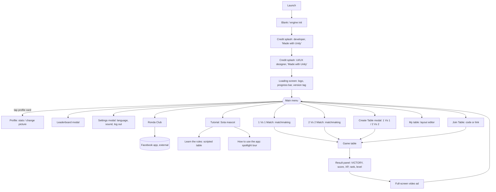
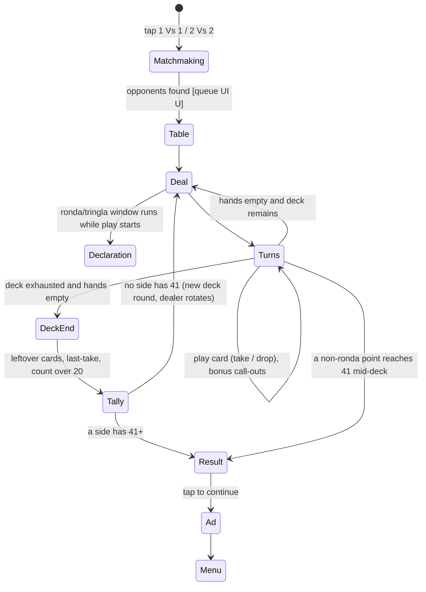

# 02 — Reference Game Analysis

**Phase:** 2 · **Status:** FINAL for Phase 2 review (observation-phase results in §10, evidence limits in §11; consolidated view in `02a_phase2_consolidated_assessment.md`) · **Date:** 2026-11-12
**Subject:** "Ronda: Moroccan Card", package `com.sandukhan.ronda`, v6.1.1 (code 43), Unity 6000.3.6f1 / IL2CPP (see `01_environment_report.md`).
**Labels (used in all of docs 02–06 and 02a):**
- **VERIFIED** — directly shown by recorded gameplay or game UI. Qualified as *visual* (a screenshot was inspected), *log-only* (only a Driver/Observer log says so) or *(tutorial)* (the game's own scripted Tutorial text, not yet seen applied in live play).
- **INFERRED** — strongly suggested by the evidence, not conclusive.
- **UNKNOWN** — insufficient evidence. Nothing is filled in from traditional Moroccan Ronda.

Earlier drafts used `[V]`, `[V-text]`, `[V-play]`, `[H]`, `[U]`; they map to VERIFIED, VERIFIED (tutorial), VERIFIED (play), INFERRED and UNKNOWN respectively.

**Evidence** is cited as capture filenames in `reference_captures/` (private, see its README): `000–020` series (main agent), `A001–A045` (Driver), `B001–B017` (Observer), plus Driver-log epochs (`@1794481xxx`, host seconds, `START` = 1794481151) and Observer files (`perf.csv`, `touch_watch.log`). "Video" means a screen recording kept only in the session scratchpad (not preserved as evidence). Usernames, avatars, table codes and profile ids visible in captures are **not** reproduced in these documents.

Companion documents: `03_game_rules_specification.md` (rules), `04_ui_ux_analysis.md` (screens/UX), `05_visual_design_specification.md` (visual requirements), `06_technical_investigation.md` (technology).

---

## 1. Method, scope and limits

| Item | Detail |
|---|---|
| Test device | Physical Samsung SM-A045F, Android 14, 720×1600 panel (landscape 1600×720), density override 280, arm64 + armv7. Official Play build of v6.1.1 (same versionCode as the XAPK analysed in doc 01). |
| Observation tools | `adb` screenshots, `screenrecord` at 1600×720, `dumpsys` focus/gfx, physical-touch counting via `getevent` (counts only), frame extraction with ffmpeg. |
| Not used (agreed D3/D4) | No IL2CPP dumping, no decompilation of game logic, no asset extraction, no traffic interception, no TLS inspection. |
| Rule sources | (1) The in-game **Tutorial** ("Learn the rules" + "How to use the app"), read end to end; (2) live matches (1v1 and 2v2) observed in screenshots and video. |
| Orientation | Game forces landscape (1600×720) even with auto-rotate off. **VERIFIED** |
| Account | One signed-in test account (the owner's). A match was already in progress at first launch. |
| Not done | No network disconnect/reconnect test (needs the owner's approval), no login-flow capture (already signed in), no Defeat result observed, no purchase flows (none declared). |

### 1.1 Session incidents (disclosed for the record)
1. **Force-stop during a possibly live match.** The app was force-stopped before checking whether a match was running. The game resumed an in-progress match on relaunch (see §6), but the owner's connection was interrupted for about a minute.
2. **Privacy capture.** The first launch recording began before the game was in the foreground and contained the owner's Gallery screen for one frame. The recording and derived frames were deleted. All later capture is focus-guarded (refuses unless the Ronda window is focused).
3. **Concurrent input.** The owner's finger was on the touchscreen while the agent was driving (8 physical touches in 32 s, correlating with card plays and menu navigation). Injected taps were verified **not** to appear on the touch panel's event stream, so those touches were real. Two early claims were retracted: that the seat "auto-plays" when idle, and that taps were vertically mirrored. After the owner went hands-off, tap mapping was verified as identity (screenshot coordinates).
4. **External app opened.** The **Ronda Club** button launches the **Facebook** app. The agent did not capture or interact with Facebook, returned to Ronda with the Back key, and Ronda Club is excluded from further exploration.
5. **Network tests not performed.** Disconnect/reconnect tests were deliberately not run (owner approval pending).

---

## 2. Application flow



*Edges marked from tutorial text or direct observation: menu items, Tutorial, Leaderboard, Settings, Create Table modal, My table, Ronda Club → Facebook, result → ad → menu are **VERIFIED**. The internal screens of Create Table (waiting room), Join Table, Profile and the matchmaking queue were observed by the Driver (§10). The result → ad → menu edge was seen once in an earlier series; the ad was not captured after the 1v1 win of this session (§10).*

### 2.1 Launch sequence **VERIFIED** (video, ~1 s resolution)
Cold start `am start -W`: `LaunchState: COLD`, `TotalTime 2040 ms` to first activity frame. Then, on the test phone:

| Approx. t from launch | Screen |
|---|---|
| 0–5 s | Blank/neutral background (engine init) |
| ≈5–9 s | Developer credit splash with a "Made with Unity" badge, fade in/out |
| ≈7–10 s | UI/UX designer credit splash (same pattern) |
| ≈10–13 s | **Loading screen**: game logo over a blurred courtyard background, progress bar, "Loading…", version tag `v6.1.1` bottom-left |
| ≈13 s | **Main menu** |

On this low-end phone the whole path takes ≈12–13 s. Timings on faster hardware are **UNKNOWN**.

A **multilingual notice modal** (Arabic/Darija, English, French, Spanish blocks; red X) appeared over the menu in one run: the ranking system has problems, is being improved, and **will be reset**. Trigger **UNKNOWN**.

---

## 3. Screens (summary; details in doc 04)

| Screen | Status | Key facts |
|---|---|---|
| Main menu | **VERIFIED** (006, 018) | Profile card (avatar + league-shield badge, name, level badge, XP bar `n / threshold`); Leaderboard, Settings; four big tiles 2 Vs 2 / 1 Vs 1 / Create Table / Join Table; Ronda Club, My table, Tutorial. |
| Settings modal | **VERIFIED** (007) | Language (5 flags: English, Arabic, Morocco/Darija, French, Spanish), Sound ON/OFF, Account → Log out, version label. |
| Create Table modal | **VERIFIED (visual)** (013, A008, A013) | Choose 1 Vs 1 or 2 Vs 2 → "Waiting Players" dialog: 4 seat slots in two halves (1v1: one open "+" seat; 2v2: three), Table Id with copy button, locked "Start" while alone, spectator eye counter 0 (A009–A015); details in doc 04 §8 |
| Leaderboard | **VERIFIED** (020) | Columns Rank · Name · Tier · Ronda Points · Win Ratio; top 3 rows medal-styled; own row pinned at the bottom (rank ≈ 11k, tier Bronze, 1010 points, 100% win ratio). Top players ≈ 1200–1260 points, tier Diamond. |
| My table | **VERIFIED** (007b, 007c) | Layout/skin editor: Back, Undo, Reset, Save, "Tap anything to move or resize it", Style. Not edited. |
| Tutorial | **VERIFIED** (016, 017_*, 019_*) | See §4. |
| Game table | **VERIFIED** | See §5. |
| Result panel | **VERIFIED** (005, video) | VICTORY, avatars with league shields, crown, score, +100 XP, ▲ +N (rank points, INFERRED), shield progress bar, level bar, "Tap to continue". |
| Post-match ad | **VERIFIED** (video, once) | Full-screen video ad ≈14 s + Close control, then menu. |
| Ronda Club | **VERIFIED** (behaviour only) | Opens the Facebook app. Not explored. |
| Join Table | **VERIFIED (visual)** (A006) | Dialog with one "Table Id" field and a Join button; nothing entered |
| Profile / avatar picker | **VERIFIED (visual)** (A002, A003) | Level, EXP bar, per-mode stats (rank, win ratio, games played/won), league bar `1010 / 1040`, copyable Id; 4-column avatar grid with Save |
| Matchmaking queue | **VERIFIED (visual)** (A016, A017, A018) | "Searching" modal: two avatars around "VS", count-up timer, Cancel; found in ≤ 3 s (log-only); placeholder table on screen at +5.6 s (A017), dealt table at +10.1 s (A018) |
| AFK takeover dialog | **VERIFIED (visual)** (A020, A021, A023, A042, B007) | "You are AFK — Bots are playing for you — I'm back" (doc 03 §3.4) |
| Defeat result, draw result, error/maintenance dialogs, sticker panel, in-match gear panel | **UNKNOWN** | not reached |

**Progression numbers VERIFIED:** level 2 needs 120 XP, level 3 needs 170 XP (profile bar `20 / 120` → after +100 XP level 3 `0 / 170`). A win gave **+100 XP** (2v2 in 005; 1v1 in A045, final value after the count-up). The test account's Leaderboard row read **1010 Ronda Points, win ratio 100%, tier Bronze** after the two earlier victories (`020_leaderboard`), and the Profile (A002, @1794481240) shows `1010 / 1040` on the league bar and level 3 at `0 / 170`. The green ▲ number next to the XP is **+10** in the 2v2 result (005) and **+9** in the 1v1 result (A045); presuming it is rank points **INFERRED** — the 1010 → ? change was not re-read after the match, so the sum is **UNKNOWN**. The league bar in the result panel is ≈ 50–55 % full (A044/A045) while the Profile bar was ≈ 97 % full (A002); the scale difference is **UNKNOWN**. Tier names seen: Bronze, Diamond, and a silver shield as the next tier (others: **UNKNOWN**).

---

## 4. The Tutorial system **VERIFIED**

Entry: menu → *Tutorial* → dimmed menu with the mascot **Sota** (the jack of the deck) and a speech bubble: *"Salam! I'm Sota. What would you like to learn?"* with two buttons: **How to use the app** and **Learn the rules**; a *Skip* label stays at top-centre throughout.

```mermaid
stateDiagram-v2
    [*] --> Choose
    Choose --> Rules : Learn the rules
    Choose --> HowTo : How to use the app
    state Rules {
        [*] --> Deck
        Deck --> Deal --> Take --> Chain --> Missa --> Ronda --> Contest --> Cap41 --> Catch --> Derba --> DeckEnd --> Count --> Done
    }
    state HowTo {
        [*] --> Profile
        Profile --> OneVsOne --> TwoVsTwo --> CreateTable --> JoinTable --> Leaderboard --> Settings --> DemoTable
        DemoTable --> YourCards --> TableMiddle --> RondaButton --> Target --> Stickers --> Scoreboard --> TableMenu --> End
    }
    Rules --> [*] : "Ready for a real game?" Close / Play 1 vs 1
    HowTo --> [*] : "Do you want to learn the rules now?" Close / Learn the rules
```

- **Rules path (31 steps):** a scripted two-seat table (You vs Rival). Passive steps have a **Next** button; interactive steps highlight a card or button with a gold outline and wait for the tap (*"Tap your 7"*, *"Tap Ronda"*, *"tap the target…"*). Sota changes pose (pointing, thinking, cheering). Score rows update live (see doc 03 for every rule quoted verbatim).
- **App path (22 steps):** spotlight tour on the real menu (dim overlay + gold highlight around the element, bubble with **Back/Next** moves around the screen), then a scripted **demo 2v2 table** with fictional player names. It explains: profile, 1v1 (*"we find you an opponent of your level"*), 2v2 (*"Start alone and we find you a partner, or share your room code so a friend joins your team first"*), Create Table (*"send the link to your friends. Others can join just to watch"*), Join Table, Leaderboard, Settings, then on the table: hand, turn glow, table centre, ronda/tringla button, catch target, **stickers**, scoreboard, in-match menu. It does **not** cover Ronda Club or My table.
- The tutorial runs on the offline scripted table; no network dependency was observed **INFERRED**.

---

## 5. Match table **VERIFIED**

```mermaid
flowchart LR
    subgraph Table[Landscape 1600x720]
      direction TB
      TL[Gear: in-match menu] --- SB[Scoreboard top-right]
      OP[Opponent / partner seats around the table] --- GRID[5x2 card slot grid in the centre]
      GRID --- HAND[Own hand fanned at bottom centre]
      HAND --- PILE[Captured-pile counter bottom-left (tutorial)]
    end
```

- **Seats:** self bottom-left nameplate; 2v2: partner opposite (top), opponents left and right; 1v1: opponent at top. Each nameplate = circular avatar + name pill. **A glow/green tint on the avatar marks whose turn it is** (**VERIFIED (tutorial)**, `019_howto_12`).
- **Opponent hands** are card-back stacks; the **dealer token** (gold medallion) sits beside the dealer's nameplate with the **deck counter** next to it.
- **Own hand** fans at the bottom centre, drawn larger than table cards, partly below the screen edge.
- **Table slots:** a faint 5 × 2 grid in the centre; played cards occupy slots.
- **HUD:** gear (in-match menu: *"share the game so friends can watch, settings, or leave the table"*, `019_howto_20`); **sticker button** beside the player's nameplate (*"React with a sticker! Tap a player's picture to see their profile or to mute their stickers"*, `019_howto_17`) — **no free-text chat observed**; **target/crosshair** icon beside each opponent (catch, doc 03 §4.6); **Ronda/Tringla** button appears beside the hand when eligible.
- **Scoreboard:** header `Us | Them` (2v2) / `Me | Rival` (1v1); **top row = cards taken this deck, bottom row = points** (**VERIFIED (tutorial)**, `019_howto_18`; VERIFIED (play) consistent across many frames). A banner below it shows *"Ronda declarations close in Ns"* then *"Ronda declarations closed"*.
- **Speech bubbles:** *Ronda!*, *2 rondas!*, *Derba! +1*, *Missa!*, *"I had a ronda! I take +1"* / *"+2"*, plus sticker reactions.
- **Match lifecycle (observed):**



Deal counts: **2v2 4 → 3 → 3 cards per player (deck counter 24 → 12 → 0), 1v1 4 per deal (deck counter 32 → 24 → 16 → 8 → 0)** — **VERIFIED (tutorial)** (`017_rules_2`) and **VERIFIED (play, visual)** (1v1: A027 = 32, A029 = 24, A033 = 16, A023 = 8; last deal A038/A039 has no counter). Table slots are **rank-addressed** (doc 03 §3.3), the table starts a deck empty (INFERRED, doc 03 §3.1), and an AFK takeover can replace a player's plays (doc 03 §3.4).

---

## 6. Multiplayer UX

| Topic | Finding | Label |
|---|---|---|
| Modes | Public 1v1 and 2v2; private tables (1v1/2v2) with a shareable **link or room code**; join by **code or link**; **spectators** can watch a started game | **VERIFIED (tutorial)** (`019_howto_5–8`) |
| Matchmaking | 1v1: *"we find you an opponent of your level. Win to climb the ranks!"* (level-based, ranked ladder). 2v2: start alone and the system finds a partner, or share a room code so a friend joins your team first | **VERIFIED (tutorial)** |
| Opponents | Players appear with usernames and avatars (the public 1v1 opponent had both, and used templated first-person speech bubbles, A021); whether any are bots: **UNKNOWN** (the only bots observed are the AFK takeover bots acting for the *test account*) | **VERIFIED (visual)** / **UNKNOWN** |
| Social | Stickers (reactions), tap a player's picture for profile or to mute their stickers; no free-text chat seen | **VERIFIED (tutorial)** |
| Leaving | Menu → "leave the table". Consequences of leaving a public match **UNKNOWN** | **VERIFIED (tutorial)** / **UNKNOWN** |
| Reconnection | A force-stopped app returned straight into the still-running match with scores intact (earlier series, 000–001; the file `006_state_after_reconnect` actually shows the menu *after* that match ended). One instance; not re-inspected during consolidation | **VERIFIED** (earlier series, one instance) |
| Disconnect UX, network-loss handling, reconnect grace period | Not tested (needs the owner's approval) | **UNKNOWN** |
| Idle / missed turns | "You are AFK — Bots are playing for you — I'm back" dialog; bots play until "I'm back" is tapped; first appearance ≤ 55.9 s after the dealt table appeared; re-appearance ≤ 20.4 s after a dismissal on a clean interval; timer value unknown (doc 03 §3.4) | **VERIFIED (visual)** dialog and takeover; timer **INFERRED/UNKNOWN**; first cycle **CONTAMINATED** |
| Results | VICTORY panel with score, XP and rank delta; the numbers count up (A044 +62/+6 → A045 +100/+9); Defeat/draw not seen | **VERIFIED (visual)** / **UNKNOWN** |

---

## 7. Observed animations and feedback (summary; timings in doc 04/05 once measured)

- Splash credits fade in/out; loading bar progresses; menu appears with no extra transition seen at 1 fps.
- **Card play:** tap → card lifts with a gold highlight → travels to a table slot → on a take, both card groups slide to the capturer's pile (a numeric pile counter updates) → bubble (*Derba!/Missa!*) → score rows update.
- **Opponent play:** a card-back flies from their stack to the slot, flips face-up.
- **Deal:** card-back stack moves to each seat; deck counter updates; ronda banner appears.
- **Modal open/close:** panel fades over a dimmed/blurred background; red round X to close.
- **Tutorial:** dim overlay with a spotlight gold outline; mascot changes pose; bubbles have a pointer toward the mascot.
- **Result:** table dims, panel fades in, *"Calculating…"* then numbers and bars fill.

---

## 8. Corrections kept from earlier drafts

- The claim that a player's seat **auto-plays** when idle is **withdrawn** (UNKNOWN); physical touches were occurring in those windows. Turn timer/timeout behaviour is open (doc 03 Q14).
- The claim that injected taps are **vertically mirrored** was **wrong**; mapping is identity.
- The scoreboard reading (top = cards taken, bottom = points) moved from hypothesis to **VERIFIED (tutorial)**.
- The exact meaning of **Derba** moved from hypothesis to **VERIFIED (tutorial)** (take the card just played by the previous player with an equal-rank card).
- Tringla value is **5**, not 3 (do not assume standard Ronda scoring).
- **"The table starts empty" vs. 8 table cards in A041:** reconciled — A041 is a *second deal* of a deck whose first eight plays captured nothing (24 + 8 + 4 + 4 = 40, captured counters 0 / 0). The Driver's filename `round_start_8_on_table` is a label, not a rule (doc 03 §3.1).
- **"Played cards occupy the next free slot"** (earlier draft) is **wrong**: slots are rank-addressed, top row ranks 1–5, bottom row 6, 7, 10, 11, 12 (A027, A029, A033, A039, A041).
- **"The AFK modal was not observed / timeouts unknown"** is superseded: the modal, bot takeover and "I'm back" were captured (A020 … A042). The timer length and the first-cycle timing remain UNKNOWN / CONTAMINATED.
- **"End-of-deck tally not independently confirmed"** is superseded: dealer-not-last +5 and cards − 20 appear in A021's bubble text, and A039 → A041 shows +6 for a 26-card haul (INFERRED decomposition). The King/Ace exceptions remain untested.
- **Driver log match-end time (@1794482109.879)** is a write time ≈ 22 s after the result panel was visible (A044 file time @1794482087.93). **Driver "+62 XP / +6 rank pts"** is a mid-animation frame; final values are +100 XP / ▲ +9 (A045).
- **"A027 shows stacked same-rank cards"** (Driver line 41) is downgraded: the two overlapped 2s coincide with a "Derba! +1" bubble and are most simply a capture animation in progress (INFERRED); same-rank stacking in a slot is UNKNOWN.
- **Driver hypothesis "10 rank slots with stacking"** keeps the first half (VERIFIED) and drops the second (UNKNOWN).

---

## 9. Remaining open items

See doc 03 §8 for rule questions (Q1–Q16, statuses updated). UI/flow items not yet observed are listed in doc 04 §13 and §12. Items resolved by the Driver/Observer sessions are in §10; the ranked list of what still matters for the design is in `02a_phase2_consolidated_assessment.md` §12–§13.

---

## 10. Results of the parallel observation phase (Driver and Observer)

Three roles worked on the phone session starting at epoch 1794481151 (`START`): a **Driver** (the only agent allowed to send input), a passive **Observer** (recordings, stills, sampling) and a **Scribe** (drafts of docs 02–06). The Scribe's drafts were written 11:03–11:08, before the Driver's results existed, which is why this section and the placeholders were still empty. The Driver's and Observer's own findings files were never produced; the evidence below comes from `driver_log.md` (44 lines), `observer_index.md`, `touch_watch.log`, `perf.csv`, `palette.json`, `events_done.json` and the screenshots.

### 10.1 Evidence inventory

| Source | Content | Notes |
|---|---|---|
| Driver screenshots `A001–A045` | 45 PNGs, file times @1794481223–@1794482092 | Several are copies from bursts (A041 and A042 share a file time), so file time can lag the real moment |
| Driver log | 44 lines (`ACTION … | RESULT … | EVIDENCE …` and `EVENT epoch=…`) | Timestamps are **write times**; some trail the screenshot by ≈ 20–30 s (e.g. match end) |
| Observer stills `B001–B017` | one still per Driver `EVENT`, cut from the recordings | **not individually inspected** during consolidation except by reference to B007/B008 |
| Observer recordings | 25 retained 30 s chunks (`chunk001–026`, chunk011 and chunk027 deleted on device unviewed because a non-Ronda window had focus), 26 contact sheets | not reviewed frame by frame; no claim below depends on them alone |
| `touch_watch.log` | 61 windows of 15 s, @1794481274.98–@1794482179.66 | real finger-down counts (§11) |
| `perf.csv` | 33 samples, @1794481323–@1794482185 | doc 06 §6, §9 |
| `palette.json` | extracted colours | doc 05 §2.1 |
| Earlier series `000–020` | tutorial, menu, settings, leaderboard, 2v2 states, 2v2 result (005) | rules text source |

### 10.2 What the Driver and Observer established

| Finding | Evidence | Strength |
|---|---|---|
| Profile, avatar picker, Join Table, Create Table waiting rooms (1v1/2v2), queue modal | A002–A018 (clean touch windows) | VERIFIED (visual) |
| 1v1 public match played to completion: victory 41 – 26, 4 deck rounds, 1v1 deck sequence 32 → 24 → 16 → 8 → 0 | A019 … A045; Driver log lines 24–44 | VERIFIED (visual) for states; plays/attribution contaminated after @1794481712 |
| End-of-deck: dealer-not-last +5, cards − 20, leftover to the last taker | A021, A039 → A041, A043 → A044 | VERIFIED (visual) numbers; decompositions INFERRED |
| Missa +1, Derba bubble, 11 → 12 chain | A031, A027, A029 → A030 | VERIFIED (visual) |
| Rank-addressed table slots | A027, A029, A033, A039, A041 | VERIFIED (visual) |
| Ronda window ≈ 15–16 s at every deal; Ronda pill | A029, A037, A041, A042 | VERIFIED (visual) / length INFERRED |
| AFK takeover with bots and an "I'm back" button | A020, A021, A023, A042, B007 | VERIFIED (visual) |
| Result panel count-up (+62/+6 → +100/+9) | A044, A045 | VERIFIED (visual) |
| Performance, two frame-rate regimes, two memory steps | `perf.csv` | VERIFIED (log-only) |
| Forced capture | Driver test `E3` | **INVALID** (§11) |

### 10.3 Observer incidents
- A notification took window focus @1794481634–644 (`NotificationShade`); the Observer's guard refused to record and deleted chunk011 unviewed.
- The recorder was replaced @1794481898 (leftover half-written chunk deleted unviewed); chunk numbering continued from 18.
- chunk027 (@1794482153.98–185.64) was deleted unviewed because a non-Ronda window had focus; **which** window is not recorded.
- The Observer's warning (index, line after chunk011): real finger-downs were detected while the Driver was not injecting; see §11.

---

## 11. Evidence contamination and limits

### 11.1 Real finger touches during the Driver session
The Observer counted `BTN_TOUCH DOWN` events on the touch panel (`getevent -lt /dev/input/event3`) in consecutive 15 s windows. Injected `adb input tap` events **never** appear there (verified earlier), so any non-zero count is a real finger. Result: **61 windows, 32 with real touches, 64 touches in total** (`touch_watch.log`, @1794481274.98–@1794482179.66). The log's epoch is the time the line was written; whether it marks the start or end of the window is not stated, so treat positions as ± 15 s. The windows before @1794481274.98 (A001–A005) were covered only by the Driver's preflight "0 touches/15 s" (log line 2, @1794481220.28).

| Phase (Driver) | Epoch range | Windows | Non-zero | Status |
|---|---|--:|--:|---|
| Menu, dialogs, waiting rooms, queue (A002–A018) | 1794481274.98–1794481410.65 | 10 | **0** | **CLEAN** (A001–A005 before the watcher started: preflight only) |
| First match minutes, first AFK dialog, "no-input burst" | 1794481425.73–1794481546.39 | 9 | **5** (2, 1, 1, 1, 1) | **CONTAMINATED** — first AFK appearance, the 125 s "no-input burst" |
| Round-1 end, AFK re-appearance, first Ronda tap (A021, A022, A023; E7 logged 1794481664.29, state shown in A022 at 1794481649.46) | 1794481561.47–1794481697.16 | 10 | **0** | **CLEAN** |
| From deck 2 to the end (A027 … A045, E1–E7, E3, E4) | 1794481712.25–1794482179.66 | 32 | **27** (up to 6 per window; 5 zero windows: 1794481802.7, 1794481908.3, 1794482134.5, 1794482149.5, 1794482179.7) | **CONTAMINATED** |

### 11.2 Which observations are affected
- **Unaffected (clean windows):** all static UI captured in A002–A018 (Profile, avatar picker, Join Table, Create Table, waiting rooms, queue modal); the round-1 end-of-deck bubble A021 and its numbers; the second AFK re-appearance after the dismissal at @1794481646.74 (≤ 20.4 s, clean interval); the 33-sample performance data (sampled by a passive agent).
- **Affected — do not use as proof:** anything that attributes a *play, Ronda tap, "I'm back" or point change to the Driver's injected input* after @1794481712 (e.g. the Ronda tap @1794481774.26 and the +1 at A033; E1 plays; E2; E4 "last capture"); the Driver's reading of the AFK timer from its own latency (≈ 12 s); the first AFK appearance (@≤1794481427.5); "no-input burst" results (@1794481458–1794481646).
- **Valid even in contaminated windows:** *what the game displays at a moment* (numbers, cards, bubbles, layout) — these are game outputs whoever tapped. They support state-based findings (rank-addressed slots, deck counters, tallies, result panel) but not who caused them.
- **Previously retracted claims** (§1.1): "mirrored taps" and "seat auto-plays when idle" came from the same cause (a real finger).

### 11.3 Driver test E3 — INVALID
`E3` (@1794481900.63, log line 39) intended to test **forced capture**: hold a 10 with a 10 on the table and play a non-matching 6. The Driver's note @1794482055.45 (line 41) records that the AFK dialog was active the whole time, so bots played the cards. Independently, the touch window @1794481893.2 held a real touch. **E3 is INVALID; forced capture is UNKNOWN. No rule in docs 02–06 or 02a rests on E3.**

### 11.4 Other limits
- One account, one public 1v1 match, one opponent; no 2v2 match, no defeat, no tringla, no catch, no network event.
- Several Driver timestamps are write times (match end @1794482109.879 vs. panel visible @1794482087.93); A041/A042 share a file time; filenames such as `A039_E3_t07` carry labels that do not match the content (final-deal state).
- Screenshots were inspected as down-scaled copies in this consolidation; B-series stills and the Observer recordings were not reviewed frame by frame.
- Tutorial text (`017_*`, `019_*`) is the authority for scoring rules that were not played (tringla 5, catch +1, ronda +1, contest rules, 41 cap). It shows the designers' intent, not that the server applies it identically.
- Earlier-series videos (e.g. the 2v2 and 1v1 "passive" watches) are not preserved; statements resting on them are marked "video".
- Usernames, avatars, Table Ids and the profile Id are visible in the preserved captures but are not reproduced in the documents.
