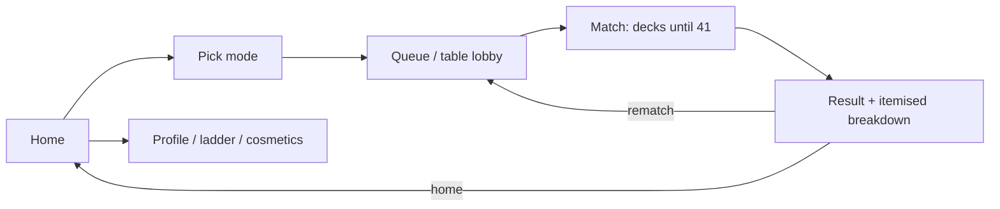

# 02 — Game Design Document (GDD)

**Deliverable A.** · **Status:** PROPOSED · **Date:** 2026-11-12 · Working title: **Zellige** (codename, D-P-01) · Tags VRO / DD / PD / OQ as in `00_README_structure.md` §2.
Rules are specified in `03_rules_and_scoring_spec.md`; this document says *what the game is, for whom, and why*.

---

## 1. Vision

An original, beautifully readable online version of Ronda, the Moroccan card game, for phones: **fast, fair, and honest about its scoring**. A player who has never seen the game can learn it in minutes; a player who has played it all their lives recognises it and trusts it.

*One-line pitch:* "Ronda at the table of a starlit riad — every point explained, every match fair."

**What we take from Phase 2 as research (VRO):** the game is played with a 40-card Spanish-suited deck, first to 41, 1v1 and 2v2, with Missa, Derba, Ronda/Tringla and Catch bonuses; the reference's UX features that worked (one-tap play, turn glow, scoreboard of "cards this deck / points", explanatory call-out bubbles, a staged result screen, interactive tutorial with a mascot) and the ones that did not (a full-screen video ad after the result, an external social link that opens another app, no visible explanation of the turn timer). **What we do differently by design:** original art direction, naming and mascot, a different table composition (rank ribbon), a visible turn timer, a two-step card play with capture preview, sealed announcements with a single resolution moment, bots always labelled, and no interstitials around a match.

## 2. Design pillars

| # | Pillar | What it means in practice | Where specified |
|---|---|---|---|
| P1 | **Every point is explained** | each score change carries a reason code, a bubble and a log line; the end-of-deck tally is shown step by step | RL-26, doc 08 §6 |
| P2 | **Fair by construction** | server-authoritative; hands and deck never leave the server; sealed announcements; no bots in ranked; deterministic, replayable matches | doc 03, 07 |
| P3 | **Respect the player's time and connection** | quick queue, one-tap rematch, reconnect that resumes the live match, autopilot instead of stalls, offline practice | doc 04, 07 §8 |
| P4 | **Rooted, not caricatured** | Moroccan material culture (zellige, lanterns, tea, riad, craft) as inspiration, not stereotype; native-speaker review of all Arabic/Darija text | doc 08, 09 |
| P5 | **Inclusive and light** | RTL-first layouts, colour-blind-safe suits, text scaling, reduced motion, low-end Android as the performance target | doc 06, 08 |

## 3. Audience and use cases

| Persona | Needs | Design response |
|---|---|---|
| **Karim**, 34, plays Ronda with family, mostly on a mid/low-end Android phone, Arabic/French | trust the scoring; recognise the rules | classic terms (Ronda, Tringla, Missa, Derba, Catch) kept; itemised tally; Arabic/Darija/French UI |
| **Salma**, 22, diaspora in Spain/France, learning the family game | learn fast, play friends remotely | interactive tutorial; private tables with a short code; ES/FR/EN UI |
| **Youssef**, 28, competitive, wants a ladder | fair matchmaking, ranking | ranked 1v1, rating tiers, replays; no bot fill in ranked |
| **Commuter sessions** | short, interruptible, unreliable network | match length ≈ 10–14 min (estimate, validate at M2), autopilot + reconnect, practice mode offline |

*Audience facts are hypotheses until playtested (OQ with the product owner).*

## 4. Platform and technical envelope (D-P-02, D-C-01)

- **Android phones, landscape**, arm64 first; iOS kept possible. Target device class = the Phase 2 test phone (low-end 20:9 panel, ≈ 1600 × 720 landscape): memory ≲ 500 MB PSS, ≥ 30 fps always and 60 fps where possible (Phase 2: reference PSS 500–625 MB, 30–60 fps on that phone).
- **Online** for ranked/casual/private; **offline** for practice vs bots and the tutorial (D-C-10).
- Unity 6 LTS (D-C-01); server in C#/.NET (D-S-02).

## 5. Game modes

| Mode | Players | Online | Ranked | Notes | Milestone |
|---|---|---|---|---|---|
| **Practice** | 1 human + bots (1v1 or 2v2) | no | no | also the dev/test harness; difficulty tiers | M2 |
| **Quick match 1v1** | 2 | yes | yes (and casual) | rating-based queue; casual may bot-fill after 12 s | M3 / M4 |
| **Private table** | 2 or 4 | yes | no | 6-character code; host can change timer/target only (RL §14); spectators later | M4 |
| **Quick match 2v2** | 4 | yes | casual first | queue alone (partner assigned) or as a party of 2 | M5 |
| **Tutorial** | 1 + scripted rival | no | no | "Learn the rules" and "Tour the app" paths | M5 |

VRO: the reference offers public 1v1, public 2v2, create/join table with a code, and a tutorial (R-matrix U01, `019_howto_*`). Spectators are described in its tutorial; we plan them after beta (D-G-02).

## 6. Core loop and session flow

**Match pacing (estimates, validate in M2 playtests):** a 1v1 deck is 40 plays (≈ 20 per player); at ~5 s per play ≈ 3.5 min per deck; reaching 41 usually takes 3–4 decks ⇒ **≈ 10–14 minutes**. The 20 s turn limit is a ceiling, not a typical turn length.

**Inside a deck round (see doc 04):** shuffle → deal → *turns* with a 15 s announcement window running at the start of every deal → captures, drops and bonus call-outs → hands empty → next deal → deck ends → **tally** (leftover, dealer rule, cards over 20) → next deck or match end.

## 7. Rules overview (plain language; normative text is doc 03)

1. Forty cards (four suits, ranks 1–7 and 10–12). Players take turns playing one card.
2. Play a card of a rank that is on the table and you **capture** it — and you keep going **up the rank order** (… 7 → 10 → 11 → 12) taking every consecutive rank that is on the table. A card that matches nothing stays on the table. There is at most one card of each rank on the table.
3. Bonus points: **Missa** (+1, you cleared the table), **Derba** (+1, you took the card the player before you just dropped), **Ronda** (+1, a pair in your hand, announced in time), **Tringla** (5, three of a kind), **Catch** (+1, you spotted a pair an opponent failed to announce).
4. When the deck runs out: leftover table cards go to whoever captured last; if the **dealer's** side did not capture last the other side gets **+5**; then each side scores **one point per card over 20**.
5. First side to **41** wins — immediately. Ronda points can only bring you to 40; a Tringla can finish the match.

## 8. Progression and rewards (all PD — product tuning, no gameplay advantage)

| Layer | Design | Notes |
|---|---|---|
| **Match XP / account level** | XP per match (win/loss/completion); levels unlock cosmetics | Reference: +100 XP per win, level 3 needs 170 XP (R31, visual) — informative, **not** copied; our curve is set at M4 |
| **Ranked rating and tiers** | Glicko-2-style rating per mode (1v1, 2v2); six craft-material tiers with divisions: Clay · Copper · Brass · Silver · Gold · Saffron | Names are working titles, original (the reference uses Bronze…Diamond); seasonal soft reset |
| **Cosmetics** | card backs, table cloths, avatar frames, sticker packs, card faces | cosmetic only; never affects rules |
| **Goals** | achievements (e.g. first Missa) and optional daily goals | post-beta; no streak pressure or loss aversion mechanics |

## 9. Social and safety (D-P-05)

- **No free-text chat.** Stickers/emotes (≈ 24, localisable) between players; players can **mute** stickers per player; **report** and **block** available from the player card (VRO: the reference offers stickers and a per-player mute — `019_howto_17`).
- Private tables use short codes from an unambiguous alphabet; codes expire; hosts can kick before start.
- Guest accounts can play casual; ranked requires a linked account (D-S-05). Usernames are validated (length, charset, profanity list per language); display names are not unique.
- External links (community, support) open in the **system browser** with a label, never another app unexpectedly (lesson from the reference's Facebook hand-off).
- Children and ads: age-rating and consent flows are decided with D-P-03; no behavioural ads to minors; no gambling mechanics and no real-money stakes — ever (stated as a design constraint).
- Legal: privacy law (e.g. GDPR; Morocco's Law 09-08 on personal-data protection — to verify with counsel) governs the profile and telemetry design (doc 07 §11).

## 10. Onboarding and tutorial (D-U-09)

Two paths, both offline and scripted, with an **original mascot** (D-U-02):

1. **Learn the rules** — ~25 short steps: deck and rank order → capture → chain → Missa → Derba → Ronda/Tringla and the announcement timer → Catch → end of deck → 41. Each step is interactive (the player makes the move).
2. **Tour the app** — home, modes, profile, private tables, settings, the table HUD.

The reference has the same two-path structure with 31 + 22 steps (VRO: R-matrix `017_*`, `019_*`); we write our own script and our own mascot and keep the steps independent of its wording.

## 11. Content, languages and culture (D-P-04)

- **Languages:** EN, FR, AR (MSA) at M5; Darija (ar-MA) and ES by M6 (the reference also ships five languages, VRO U01/T01). RTL from the first UI build (SP-1).
- **Terminology:** keep Ronda, Tringla, Missa, Derba, Catch ("Catch" may be localised) as game words with in-app explanations; Arabic script and Latin transliteration shown consistently.
- **Cultural review:** every user-visible string and image reviewed by a native speaker; avoid religious iconography on cards/tables; avoid stereotyped depictions; tea, lanterns, tiles, textiles, brass work are the motif pool.
- **Art direction** (D-U-01, doc 08 §2): original; deliberately unlike the reference's café-courtyard + teal-felt look.

## 12. Monetisation (OQ D-P-03)

Deferred; constraints fixed now: no interstitials in or right after a match; no pay-to-win; no real-money wagering; no loot boxes. Candidate (post-beta): cosmetic store and an optional ad-free supporter pack. The catalogue is designed as data so any model can be added later.

## 13. Telemetry and success metrics

*Consent-gated (D-S-12); no personal content.* Events: app start, tutorial step, queue start/found/cancel, match start/end, deck tally reasons, timeouts/autopilot, reconnects, disconnect causes, crash, frame-time buckets.

| Metric | Why | MVP target (hypotheses to calibrate at soft launch) |
|---|---|---|
| p50 / p95 time-to-match (1v1) | queue health | ≤ 10 s / ≤ 30 s at expected concurrency (estimate) |
| Reconnect success within grace | reliability | ≥ 98 % |
| Crash-free sessions | stability | ≥ 99.5 % |
| Tutorial completion | learnability | ≥ 70 % of new players |
| Match completion rate (not abandoned) | engagement | ≥ 90 % |
| Frame time on the target device | performance | ≥ 30 fps always, median ≥ 50 fps in matches (doc 10 gates) |

## 14. Risks

| Risk | Impact | Mitigation |
|---|---|---|
| Unknown reference behaviours (capture obligation, timers, …) | rules disagree with player expectations | ruleset flags (doc 03 §13), playtests, optional clean observation session (OQ-R1) |
| Arabic/Darija text quality and RTL layout in Unity | UX defect for a core audience | spike SP-1 before art; native QA; UI Toolkit + ATG with uGUI fallback (D-C-03) |
| Low-end performance | frame drops / crashes | budgets in doc 06 §9; SP-3 on the target device |
| Cheating/collusion in 2v2 | unfair matches, churn | server authority, sealed info, no free chat, collusion heuristics, replay audit |
| Cold-start liquidity for matchmaking | long queues | casual bot fill (labelled), wider rating windows, private tables |
| Art/legal similarity to the reference | takedown risk | original direction, provenance register, side-by-side review checklist (doc 08 §11) |
| Scope growth | schedule | milestone gates (doc 11); 2v2 and spectators sequenced after 1v1 |
| Team/skill uncertainty | wrong backend choice | OQ D-P-07; the recommendation (custom .NET) is **sensitive** to team capacity: with ops/speed weighted higher, UGS-centric or Nakama score higher (doc 07 §3.3); decide at M0 |

## 15. Out of scope for v1

Real-money features; free-text chat; voice; tournaments; clubs/guilds; web or desktop builds; user-generated card art; spectator mode (after beta); 2v2 derba escalation (D-G-21).
