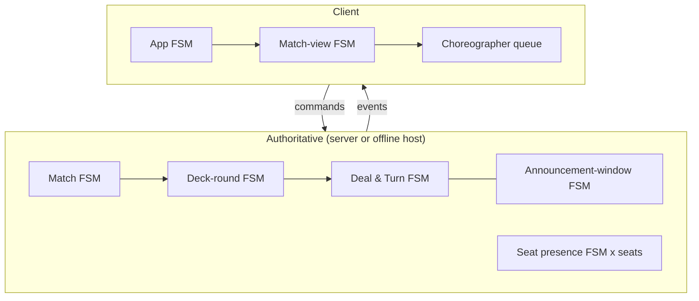
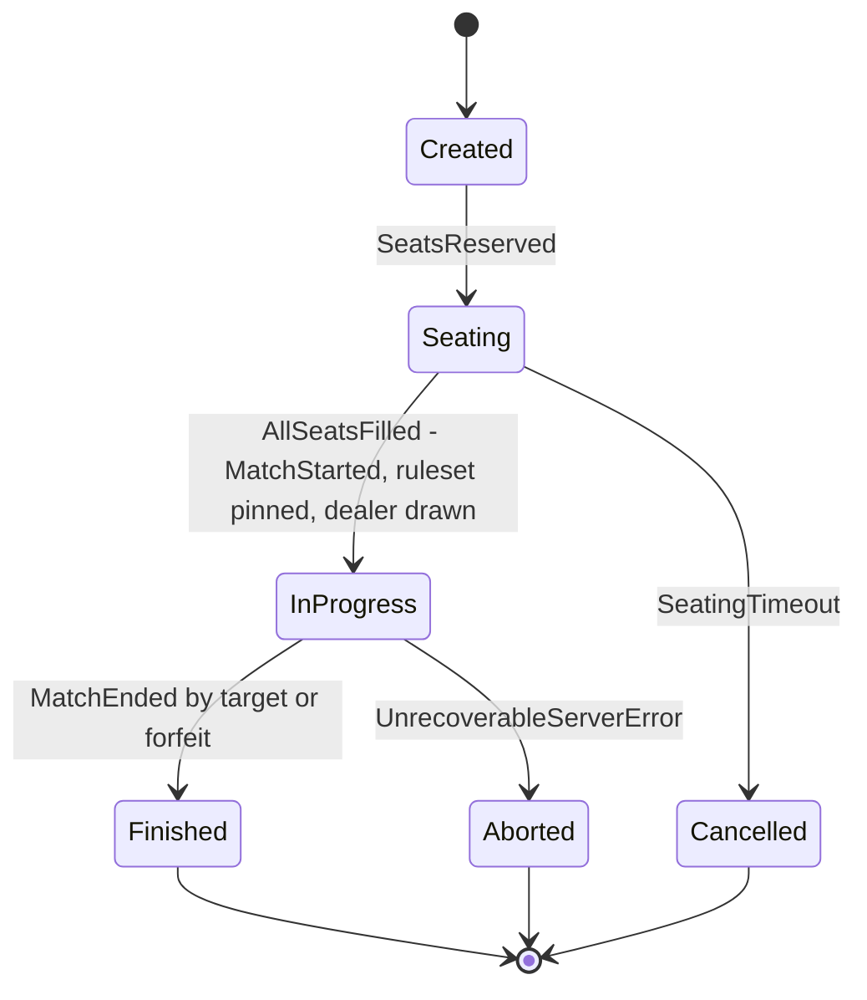
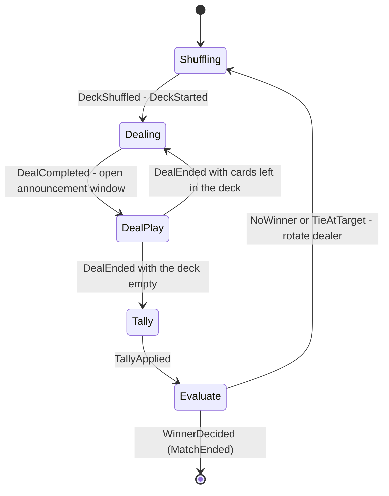
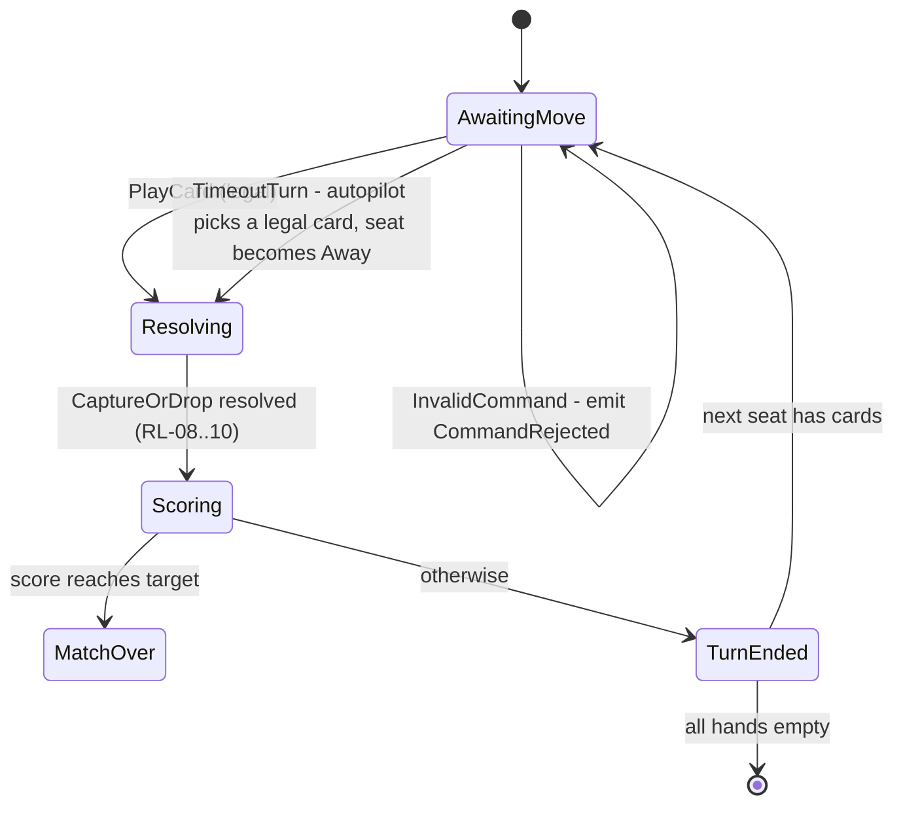
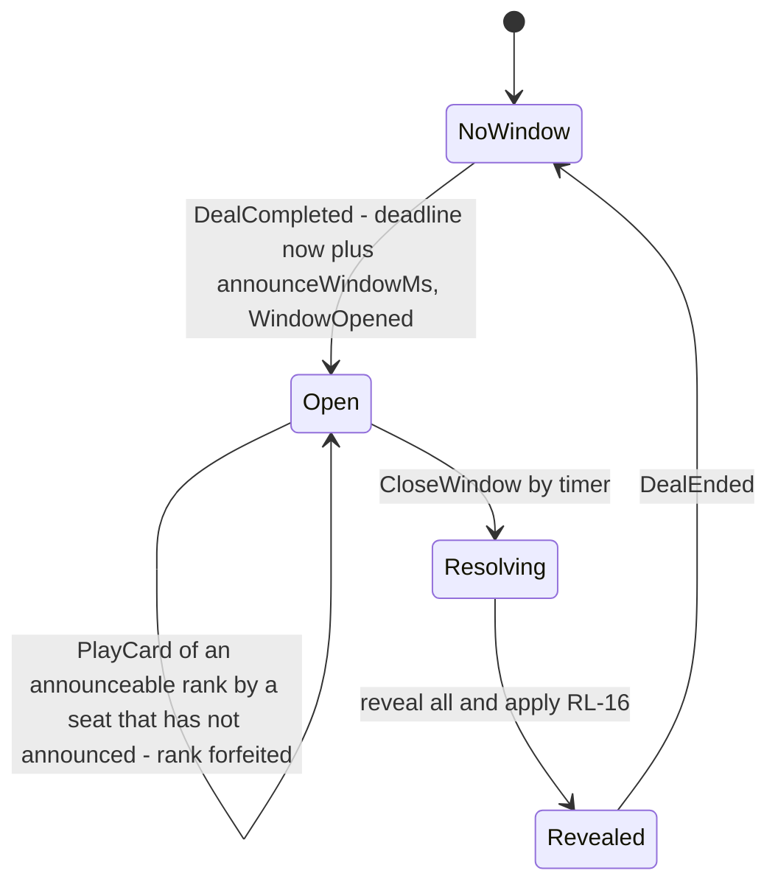
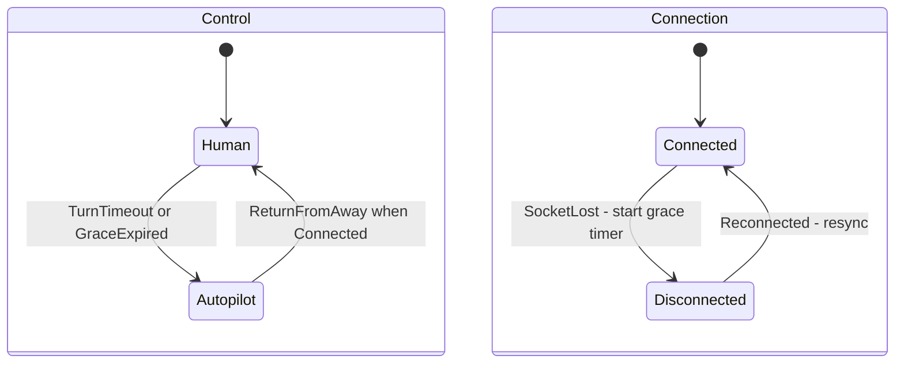
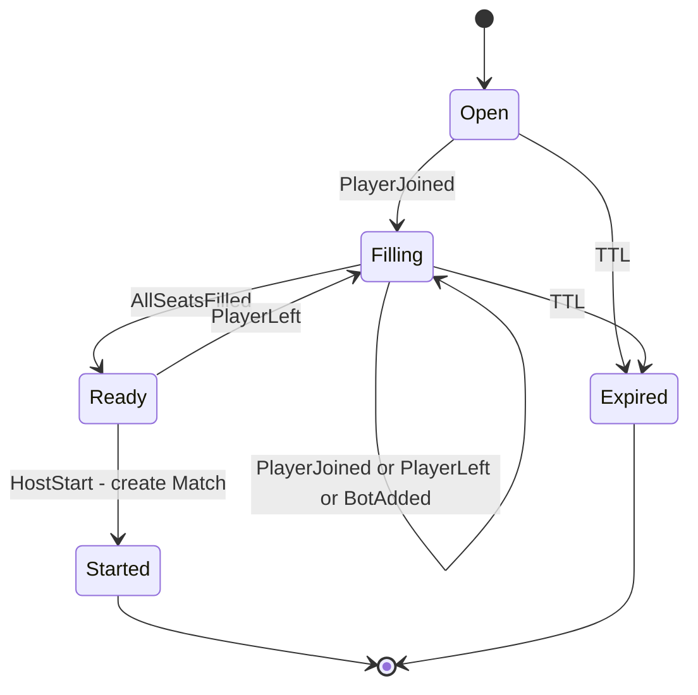
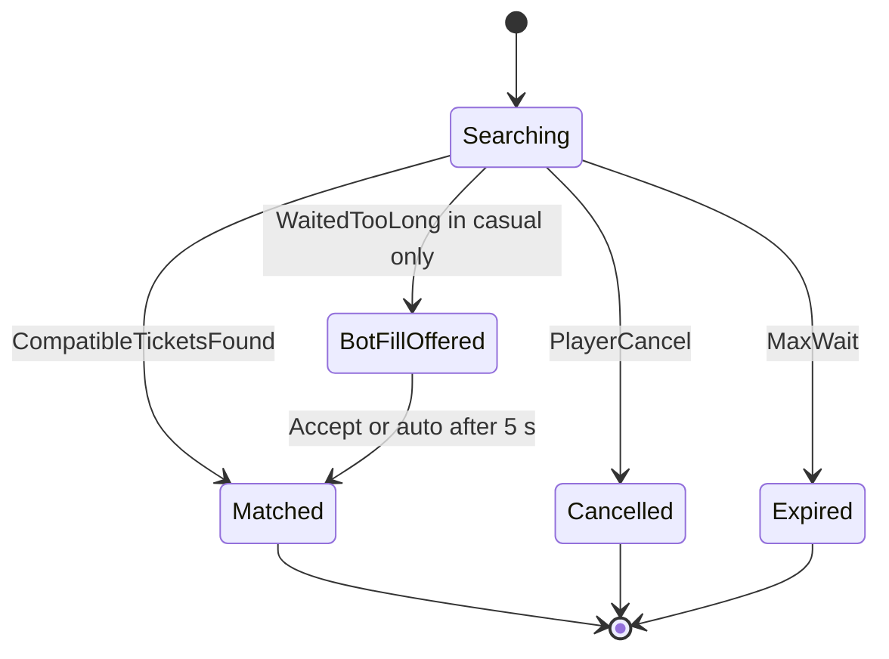
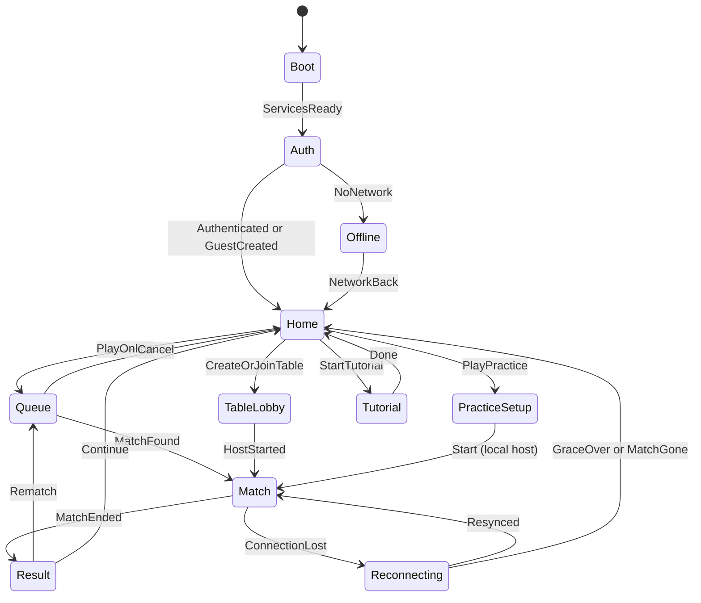
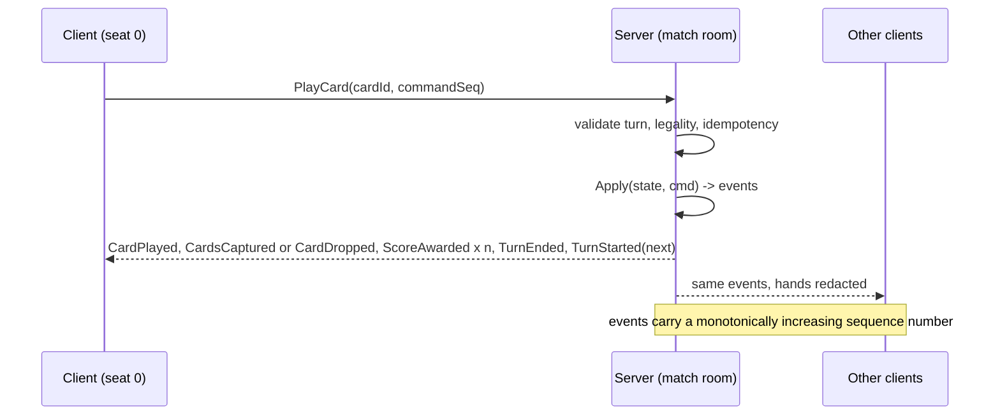

# 04 — Gameplay State Machines and Transitions

**Deliverable C.** · **Status:** PROPOSED · **Date:** 2026-11-12
**Scope.** Authoritative (server) machines for match, deck round, deal/turn, announcement window and seat presence; lobby and matchmaking machines; client application and presentation machines; two sequence diagrams (play a card, reconnect). Rules referenced as `RL-nn` (doc 03), commands/events as in doc 05 §6–§7. **All timings are ruleset flags**; defaults from doc 03 §13.
**Conventions.** `[guard]` · `/ action` · events in `CamelCase` · times use the server clock only.

---

## 1. Layering



The **engine is a pure function**: `Apply(state, command, now) → (state', events[])`. The machines below describe the states encoded in `MatchState` and the transitions the engine performs; timers are *inputs* (`TimeoutTurn`, `CloseWindow` commands issued by the host's scheduler), never hidden side effects.

---

## 2. Match FSM (server)



| From | Event | Guard | Action | To |
|---|---|---|---|---|
| Created | SeatsReserved | matchmaking/lobby produced a roster | create `MatchState`, ruleset pinned | Seating |
| Seating | AllSeatsFilled | every seat has a human or a labelled bot | draw first dealer; emit `MatchStarted` | InProgress |
| Seating | SeatingTimeout | no quorum within the limit | release seats; notify | Cancelled |
| InProgress | MatchEnded | RL-23 or RL-25 | write result, ratings job, close room | Finished |
| InProgress | UnrecoverableServerError | state cannot be restored | mark void, no rating change, notify | Aborted |

*Match is Finished only through the engine's `MatchEnded` event (RL-23); the host never edits scores.*

---

## 3. Deck-round FSM (inside InProgress)



| From | Event | Guard | Action | To |
|---|---|---|---|---|
| Shuffling | DeckShuffled | seed drawn server-side (RL-06a) | clear table, piles, per-deck counters; rotate dealer (except first deck) | Dealing |
| Dealing | DealCompleted | all hands filled per RL-05 | emit `DealStarted` (hands redacted per seat), set first player (RL-06b), open window (RL-15) | DealPlay |
| DealPlay | DealEnded | all hands empty | emit `DealEnded` | Dealing / Tally |
| Tally | TallyApplied | RL-19 → RL-20 → RL-21 | emit `DeckTallied` with itemised ledger entries | Evaluate |
| Evaluate | WinnerDecided | RL-23 | emit `MatchEnded` | — |
| Evaluate | NoWinner | no side at target, or exact tie at target (`bothReachTarget`) | — | Shuffling |

Mid-play, `MatchEnded` can be emitted from DealPlay at any `ScoreAwarded` that reaches the target (RL-23 (a)); the machine then leaves directly to `[*]`.

---

## 4. Deal and turn FSM



| State | Entry actions | Exit conditions |
|---|---|---|
| **AwaitingMove** | set `turnSeat`, `deadline = now + turnTimerMs`; emit `TurnStarted(seat, deadline)`; if the seat is **Away**, schedule an immediate humanised autopilot move (0.8–1.5 s) | `PlayCard` valid · `TimeoutTurn` |
| **Resolving** | remove the card from hand; RL-08/09 capture or RL-10 drop; emit `CardPlayed`, `CardsCaptured` or `CardDropped`; update `lastDrop` (cleared by any capture, set by any drop) | always → Scoring |
| **Scoring** | evaluate Missa (RL-12), Derba (RL-13); each award → `ScoreAwarded(reason)`; check RL-23 (a) after each | MatchOver or TurnEnded |
| **TurnEnded** | emit `TurnEnded`; advance `turnSeat` to the next seat with cards (counter-clockwise) | next turn / deal end |

Commands that are **not** turn-bound (can arrive in any state of DealPlay): `Announce` (window open), `Catch`, `ReturnFromAway`, `Leave`, sticker sends (cosmetic, ignored by the engine).

**Idempotency.** Each command carries `(matchId, seat, commandSeq)`; a repeated `commandSeq` returns the original outcome without effect (needed for reconnect).

---

## 5. Announcement-window FSM (parallel with turns)



- **Sealed**: `AnnouncementAccepted` goes only to the announcing seat (ack); other seats learn nothing until `AnnouncementsRevealed` (RL-15).
- **Catch** becomes available in **Revealed** (RL-18), until `DealEnded`; a successful or failed catch is recorded per `(target, rank, deal)`.
- A window exists for **every deal** (VRO R15: visual in A029, A037, A041, A022).
- If the match ends while Open/Resolving, pending announcements are discarded.

---

## 6. Seat presence — two orthogonal flags

**Control** ∈ {Human, Autopilot} and **Connection** ∈ {Connected, Disconnected}; plus a terminal result {None, Forfeited, Left, Replaced}.



| Event | Effect | Notes |
|---|---|---|
| `TurnTimeout` | Control: Human → Autopilot; autoplay counter = 1; emit `SeatAway(seat)` | VRO R30: bots play, "I'm back" (visual) |
| Autopilot turn | autoplay counter += 1 | ranked: counter ≥ 8 → `Forfeited` (RL-25) |
| `ReturnFromAway` | Autopilot → Human at the seat's **next** turn; counter reset | requires Connected |
| `SocketLost` | Connection: Disconnected; grace timer `reconnectGraceMs` (default 60 000); emit `SeatDisconnected` | the seat's turns continue normally until its timer expires → autopilot |
| `GraceExpired` | Control → Autopilot | the seat is still reconnectable until `Forfeited` or match end |
| `Reconnected` | Connection: Connected; the client receives a **snapshot** (§10) | Control stays Autopilot until the human returns |
| `Leave` | ranked 1v1 → `Forfeited`; casual/private/2v2 → `Replaced` by a labelled bot | RL-25 |

---

## 7. Lobby and matchmaking machines

### 7.1 Private table (room)



Guards: only the host may `Start`; 1v1 needs 2 filled seats, 2v2 needs 4; a code is valid only while Open/Filling/Ready; spectators (post-beta) attach to Started rooms read-only.

### 7.2 Matchmaking ticket



Parameters (doc 07 §6): rating window starts ±100 and widens by ±50 every 5 s; casual bot fill after 12 s; ranked never bot-filled (D-S-08).

---

## 8. Client application FSM



`Match` has a nested **match-view FSM**: `Connecting → Syncing → Live ⇄ Animating → Live`, plus `Away` overlay (AFK dialog) and `Paused` (app backgrounded). In offline practice the same `Match` state is driven by a local host (D-C-10).

### 8.1 Match-view FSM and input gating

| State | Meaning | Input |
|---|---|---|
| Syncing | applying a snapshot or replaying events without animation | disabled |
| Live-Idle | event queue empty, state consistent | enabled if it is my turn |
| Animating | the choreographer is playing queued events | disabled for card play; announce/catch buttons stay available when legal |
| AwaitingConfirm | (two-step play) a card is lifted with a capture preview | tap again to play, tap elsewhere to cancel |
| Away | autopilot active, AFK dialog shown | only "I'm back" |
| Reconnecting | socket down | disabled; banner |

The client never changes game state; it applies **events** from the host in order. Optimistic UI is limited to lifting a card and showing the preview; a play is only *shown* after `CardPlayed` arrives.

---

## 9. Sequence — play a card



If validation fails the server answers `CommandRejected(reason)` and state is unchanged.

## 10. Sequence — reconnect

```mermaid
sequenceDiagram
  participant C as Client
  participant G as Gateway
  participant R as Match room
  C->>G: Connect(token) ... socket lost
  Note over R: SocketLost -> grace timer; turns continue
  C->>G: Resume(sessionId, lastEventSeq)
  G->>R: attach
  alt gap is small, at most N events and retained
    R-->>C: events (lastEventSeq+1 ..)
  else
    R-->>C: Snapshot(PlayerView at seq K) + events (K+1 ..)
  end
  R-->>C: SeatState (Autopilot? deadline?)
  C->>C: Syncing -> Live; if Away: show "I'm back"
```

Snapshot = the seat's redacted `PlayerView` (doc 05 §8): hand, table, piles counts, scores, turn, deadlines, announcement state (own sealed announcements only), lockout flags.

## 11. Invariants checked by every machine (full list: doc 05 §5)

Card conservation (40 cards always partitioned); at most one card per rank on the table; the current `turnSeat` holds ≥ 1 card; exactly one announcement window per deal; the ledger sum equals the displayed score; `MatchEnded` is emitted exactly once.
