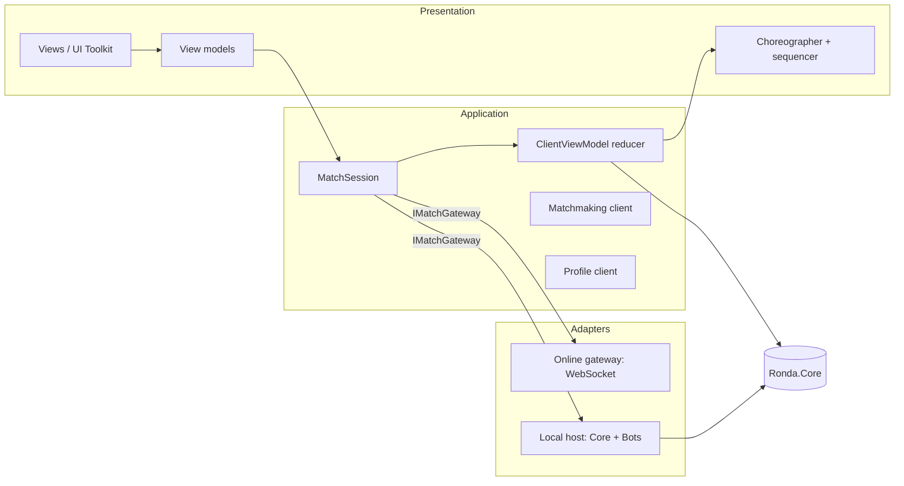

# 06 — Unity 6 Technical Architecture

**Deliverable E.** · **Status:** PROPOSED · **Date:** 2026-11-12 · Decisions: D-C-01…D-C-12 (`01_decision_register.md`). **No code is given; nothing is installed.** Every package named here is a *candidate*; installing it requires the owner's approval (D-P-06).

---

## 1. Goals and constraints

| # | Goal / constraint | Source |
|---|---|---|
| G1 | The rules live in one engine-independent, unit-testable assembly shared by client, server and tests | project rule; D-C-04 |
| G2 | The online path is server-authoritative; the client only sends intents and renders events | D-S-01 |
| G3 | The same match UI runs online, offline (practice) and in the tutorial | D-C-10 |
| G4 | Arabic/Darija RTL and Latin text are first-class | Phase 2 (R-matrix U01, T01); D-C-03 |
| G5 | Runs well on a low-end Android phone | Phase 2 T03: reference PSS 500–625 MB, graphics 210–291 MB, 138–160 threads, 30–60 fps on the test phone (log-only) |
| G6 | Result/menu flow must not leak memory | Phase 2 T04: +82 MB PSS / +61 MB graphics between samples bracketing the match end (cause UNKNOWN) → we add a post-match memory gate (doc 10) |
| G7 | Clean-room: no reference assets, code or text | Phase 2 doc 05 §12 |

## 2. Technology baseline (PD, D-C-01…D-C-12)

| Area | Choice | Notes |
|---|---|---|
| Editor | **Unity 6.3 LTS** (6000.3.x). Verified: 6.3 LTS released 2025-12-04, supported until December 2027; 6.0 LTS standard support ends October 2026 | the installed 6000.6.4f1 has no Android module (doc 01); installing editor/module needs approval |
| Scripting | C# on IL2CPP, arm64 | armv7 only if the device matrix demands it (SP-3) |
| Rendering | URP with the 2D Renderer | 2D lights for lantern glow, sprite atlas batching |
| UI | UI Toolkit (runtime) for menus/HUD, **Advanced Text Generator** for Arabic; 2D world objects for cards/table | spike SP-1; fallback uGUI + TextMeshPro + RTL plugin |
| Input | Input System package | touch first |
| Content | Addressables (local-first) | remote only for cosmetics later |
| Localisation | Unity Localization | smart strings, plurals |
| Serialization (wire) | MessagePack candidate; Newtonsoft (`com.unity.nuget.newtonsoft-json`) for dev/debug | D-S-04 |
| Animation | Awaitable-based sequencer + tweens; PrimeTween (licence to verify) candidate | D-C-07 |
| DI | hand-written composition root; VContainer candidate | D-C-06 |

## 3. Repository and assembly layout

```
repo/
  docs/                         (this documentation)
  src/
    Ronda.Core/                 pure C#, netstandard2.1, package.json + .asmdef (UPM-consumable), NO engine refs
    Ronda.Core.Build/           SDK-style csproj that globs ../Ronda.Core/**/*.cs (keeps obj/bin out of the package folder)
    Ronda.Protocol/             message types + codecs (depends on Core)
    Ronda.Bots/                 bot and autopilot policies (depends on Core)
    Ronda.Server/               ASP.NET Core host (doc 07)
  tests/
    Ronda.Core.Tests/           NUnit, run by `dotnet test` (no Unity)
    Ronda.Simulation/           CLI: self-play, fuzz, balance statistics
    Ronda.Server.Tests/
  unity/RondaClient/            Unity project; Packages/manifest.json references "com.ronda.core": "file:../../src/Ronda.Core" (and Protocol, Bots)
```

**Why a `file:` UPM package for Core (D-C-04).** One source tree, compiled twice: by Unity (asmdef) and by .NET (csproj glob). No DLL copying, full Unity debugging, and `dotnet test` stays independent of the editor. **Risk:** Unity importing `obj/` files — avoided by the separate `*.Build` project. Verified in spike **SP-2**.

### 3.1 Assemblies (asmdef) and allowed references

| Assembly | Contains | May reference |
|---|---|---|
| `Ronda.Core` | domain model, engine, ruleset (doc 05) | nothing (`noEngineReferences`) |
| `Ronda.Protocol` | wire DTOs, codecs | Core |
| `Ronda.Bots` | bot policies | Core |
| `Ronda.Client.Application` | use cases: `MatchSession`, `MatchmakingClient`, `ProfileClient`, ports (interfaces) | Core, Protocol |
| `Ronda.Client.Net` | WebSocket transport, reconnect, codecs wiring | Application, Protocol |
| `Ronda.Client.Local` | `LocalMatchHost` (offline practice, tutorial) | Application, Core, Bots |
| `Ronda.Client.Presentation` | choreographer, card/table views, view models | Application, Unity |
| `Ronda.Client.UI` | UXML/USS screens and controllers | Presentation |
| `Ronda.Client.Audio`, `…Localization`, `…Platform` | audio mixer wrapper, locale services, Android bridges (haptics, share, keystore) | Application |
| `Ronda.Client.Bootstrap` | composition root, scene flow | everything |
| `Ronda.Client.Tests.*` | EditMode and PlayMode tests | as needed |

**Rules:** dependencies point inward (Presentation → Application → Core); Core never references Unity; `Net` and `Local` implement ports declared in `Application`; no assembly references `Bootstrap`.

## 4. Layered view (ports and adapters)



**Ports (interfaces in Application):** `IMatchGateway` (send commands, receive events, snapshot/resync), `IAuthService`, `IMatchmakingService`, `IProfileService`, `IStorage` (settings, secure token), `IClock`, `ILogger`, `IAnalytics` (consent-gated), `IHaptics`.
**Adapters:** `OnlineMatchGateway` (WebSocket + codec), `LocalMatchGateway` (hosts a `MatchState`, runs bots/timers). Both expose the same event stream, so the UI cannot tell them apart.

## 5. Match session and presentation pipeline

1. `IMatchGateway` yields **ordered events** (doc 05 §7) with sequence numbers.
2. `MatchSession` applies each event to a **client view model** (`PlayerView` reducer in Core — a projection that needs no hidden information) and emits **presentation steps**.
3. The **choreographer** is a FIFO queue of steps (e.g. "flight → capture sweep → score bubble → timer start"). Steps are Awaitable coroutines with cancellation and a **speed multiplier**.
4. **State is never driven by animation.** The view model already holds the final state; if the queue falls behind (slow device, backgrounding, resume) the choreographer **fast-forwards** (snaps to the final state, skipping non-essential motion) and the HUD stays correct.
5. **Input gating** follows doc 04 §8.1: input is enabled only when the queue is empty and it is the local seat's turn (announce/catch buttons stay available when legal).
6. **Two-step play (D-U-04):** `AwaitingConfirm` computes the capture preview locally with Core's `CaptureResolver` (read-only) and highlights the sockets that would be captured.

### 5.1 Event → step mapping (examples)

| Event | Steps |
|---|---|
| `DealStarted` | shuffle → deal flights (per seat) → counter tick → announcement banner |
| `CardPlayed` + `CardDropped` | hand → socket settle |
| `CardPlayed` + `CardsCaptured` | hand → table → pull captured to the capturer's pile (chain highlight in order) → pile counter |
| `ScoreAwarded` | bubble at the beneficiary + scoreboard tick + log line (reason localised) |
| `AnnouncementsRevealed` | flip announced cards, banner, contest result |
| `DeckTallied` | one row per tally component (leftover → dealer rule → over 20) |
| `MatchEnded` | result sequence (doc 08 §6.7) |

## 6. Scenes, flow and UI technology

- **One bootstrap scene** with a persistent composition root; **additive scenes**: `Home` (UI Toolkit), `Match` (2D world + HUD `UIDocument`), `Tutorial` (reuses `Match` with `ScriptedMatchHost`). Addressables groups: `core-ui`, `cards`, `themes/<theme>`, `audio`, `l10n`.
- **UI Toolkit** screens are UXML + USS with **design tokens as USS variables** (doc 08 §3); data binding to view models; RTL via `LanguageDirection` plus ATG (dynamic font assets with Arabic coverage). Known limits to design around (verified): some rich-text tags (`<sprite>`, `<size>`, `<font>`) are not supported by ATG yet → icons are separate elements, not inline sprites.
- **Cards and table** are 2D world objects: pooled card prefabs (40 faces + back), a sprite atlas per theme, sorting layers, URP 2D lights, particles for Missa/Derba. The table's 10 rank sockets are anchors on the curved ribbon (D-U-03).
- **SP-1 pass criteria:** EN/FR/AR screens with mixed digits and RTL punctuation render correctly; a 4-card hand and 10 sockets run ≥ 55 fps on the target device; text scales to 150 % without clipping.

## 7. Offline practice and tutorial (D-C-10)

`LocalMatchGateway` hosts a `MatchState` in-process and drives timers from the Unity player loop through `IClock`; bots come from `Ronda.Bots`. The **tutorial** uses `ScriptedMatchHost`, which starts a match from a **fixed deck order and scripted opponent moves** (the engine accepts an explicit deck order in `StartMatch` for tests and scripts). The online and offline paths produce identical events, so the same view code and tests apply.

## 8. Networking client (online)

| Topic | Design |
|---|---|
| Transport | WebSocket over TLS to the gateway; `System.Net.WebSockets.ClientWebSocket` if it behaves on Android IL2CPP (SP-4), else a small permissively-licensed library (approval) |
| Framing | binary MessagePack envelope `{v, type, seq, payload}` (doc 07 §5); JSON codec in debug builds |
| Heartbeat | ping every 10 s, dead after 25 s |
| Reconnect | exponential backoff 0.5 s → 8 s with jitter; `Resume(sessionId, lastEventSeq)`; snapshot fallback (doc 04 §10) |
| App lifecycle | on pause: stop sending, keep the session id; on resume: reconnect immediately; never assume a background socket survives |
| Time | the client trusts server deadlines (`deadline` in server ms) and estimates clock offset from pings; countdowns are cosmetic |
| Errors | error codes (doc 05 §12) → localised toasts; unauthorised → re-auth |

## 9. Performance budgets (targets; gates in doc 10)

*Reference measurements (Phase 2, log-only): PSS 500–625 MB, graphics 210–291 MB, 138–160 threads, 30–60 fps, 2,040 ms cold start, ≈ 12–13 s launch to menu on the same phone. Our budgets are deliberately tighter.*

| Metric | Budget (target phone class) |
|---|---|
| PSS in a match | ≤ 450 MB (hard ceiling 520 MB) |
| Graphics memory | ≤ 180 MB |
| After returning from a match to Home | within +40 MB of the pre-match baseline after 30 s (post-match memory gate) |
| Threads | ≤ 100 |
| Frame rate | ≥ 30 fps minimum; match median ≥ 50 fps; vsync-aligned frame pacing |
| Draw calls in a match | ≤ 80 |
| Texture memory | ≤ 80 MB (atlased, ASTC) |
| Cold start to Home | ≤ 6 s |
| Download size (AAB, base) | ≤ 100 MB (initial), cosmetics on demand |
| GC allocations | 0 per frame in steady state; no GC pause > 3 ms during a match |
| Battery/thermals | no sustained throttling in a 30-minute session |

Measures: sprite atlases, pooled objects, no per-frame allocations in presentation code, Addressables unload on scene exit, UI Toolkit element pooling for lists, no real-time shadows, simple particle budgets, `Application.targetFrameRate` tied to a performance setting (30/60).

## 10. Localisation and RTL (D-C-09)

String tables per locale; smart strings with plural rules; fonts per locale as **dynamic font assets**; number formatting (Western digits default; Arabic-Indic as a setting). **Mirroring rules (DD):** menus, lists and dialogs mirror in RTL; the **table is spatial and does not mirror** (your seat stays bottom, the order of seats is unchanged); the scoreboard keeps "own side first" and its position follows the reading direction of the HUD; numbers inside Arabic text stay LTR runs.

## 11. Build, CI and release engineering

- Unity batch-mode builds (GameCI-style) or a local build machine; CI runners need a Unity licence → owner decision. Android App Bundle, IL2CPP, arm64; symbols uploaded to the crash tool chosen in D-S-12.
- Versioning: semantic app version + `rulesetId`/`protocolVersion` negotiated at connect (server can refuse outdated clients gracefully with an "update required" screen).
- Pipelines: `dotnet test` for Core/Protocol/Bots/Server on every commit; Unity EditMode tests on every PR; PlayMode and device-farm smoke on nightly; performance run on the target device before each milestone.
- Store: Play internal → closed → open testing; Play Integrity (post-beta, ranked).

## 12. Client-side security and privacy

No secrets in the client; tokens in the OS keystore (small native bridge or a vetted plugin — spike); TLS only; no card information beyond `PlayerView`; analytics and crash reporting gated by consent; no copy of reference assets in the project; debug menus stripped in release.

## 13. Observability in the client

A debug overlay (fps, memory, event seq, ping, queue depth), a **match recorder** (event log export for bug reports), deterministic **replay viewer** (feeds recorded events through the same pipeline), structured logs with log levels and ring buffer attached to crash reports.

## 14. Third-party candidates (all need approval and licence verification — D-P-06)

| Candidate | Purpose | Licence status |
|---|---|---|
| Unity packages: Addressables, Localization, Input System, 2D Animation, Newtonsoft Json (`com.unity.nuget.newtonsoft-json`) | content, l10n, input, animation, JSON | Unity package terms |
| VContainer | DI | verify at selection (believed permissive) |
| PrimeTween | tweening | verify at selection |
| MessagePack-CSharp | wire serialization | verify at selection (believed MIT) |
| NUnit / Unity Test Framework | tests | standard |

## 15. Risks and spikes

| ID | Spike | Question | Exit |
|---|---|---|---|
| **SP-1** | UI Toolkit + ATG with Arabic/RTL and a card hand on the target device | UI technology (D-C-03) | pass criteria in §6 |
| **SP-2** | `file:` UPM package for Core plus .NET csproj glob | single-source Core (D-C-04) | Unity compiles; `dotnet test` green; no `obj/` imported |
| **SP-3** | Performance on the target phone class (memory, fps, thermals, arm64/armv7) | budgets, device matrix, minSdk (D-C-11) | §9 budgets |
| **SP-4** | WebSocket on Android IL2CPP (TLS, background/resume, reconnect) | transport library | reconnect scenario passes |
