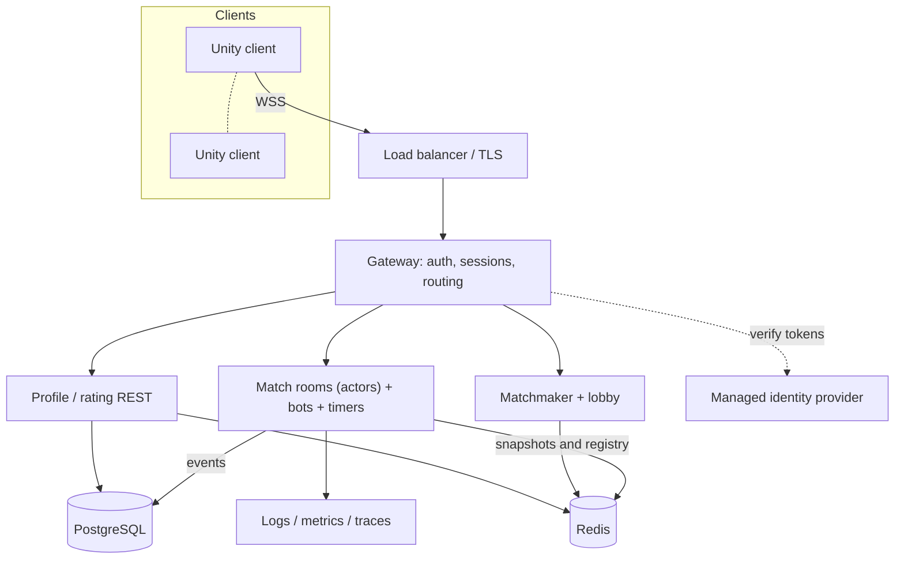

# 07 — Multiplayer and Backend Architecture

**Deliverable F.** · **Status:** PROPOSED · **Date:** 2026-11-12 · Decisions: D-S-01…D-S-13 (`01_decision_register.md`). Nothing is provisioned, created or installed; cloud accounts and vendor sign-ups need the owner's approval.

---

## 1. Requirements

| # | Requirement | Origin |
|---|---|---|
| F1 | **Authoritative server**: dealing, turns, legal moves, captures, scoring, timers; hidden information never reaches other clients | project rule, D-S-01 |
| F2 | One rules implementation shared with the client (offline mode, previews, tests) | D-C-04 |
| F3 | Timers on the server clock: 20 s turns, 15 s announcement windows, reconnect grace | RL-15, 24 |
| F4 | Real-time push of events to 2–4 players (+ spectators later) | doc 04 |
| F5 | Reconnect that resumes the live match; autopilot for absent players | VRO R30 (visual), M03 (one earlier instance) |
| F6 | Matchmaking: rating-based 1v1, 2v2 with partner assignment or party, private tables by code | VRO tutorial (level-based, partner search, code/link) |
| F7 | Bots: autopilot, practice, casual fill, tests — never in ranked | D-S-08 |
| F8 | Persistent profiles, stats, ratings, leaderboards, match history | VRO U02 (Profile), leaderboard 020 |
| F9 | Anti-cheat and abuse resistance; privacy by design | D-S-11, D-P-05 |
| F10 | Observability, safe deploys, bounded cost; MVP runs in one region | D-S-12, D-S-13 |

**Phase 2 limits to respect.** The reference's wire protocol and backend were never inspected (D4); Firebase/UGS/WebSocket libraries were only *present* in its package (T01, T02 UNKNOWN). Our choices are made from our own requirements and public documentation, not from the reference.

---

## 2. Facts used (web-verified 2026-11-12 unless marked)

| Fact | Source |
|---|---|
| Unity **Multiplay Game Server Hosting** was deprecated at the end of March 2026 (Unity docs: 31 March 2026; status page: 1 April 2026). **Matchmaker, Relay and Distributed Authority continue.** | Unity Matchmaker support page; Unity status notice "Multiplay Deprecation"; vendor blogs |
| **Cloud Code C# modules** are .NET libraries run server-side (up to .NET 9), **cannot use Unity runtime APIs**, are the recommended way to run server-authoritative code; stateful Cloud Code exists | Unity Cloud Code docs |
| UI Toolkit's Advanced Text Generator supports Arabic shaping and RTL; uGUI/TextMeshPro are not covered | Unity manual / forums (doc 06) |
| **Nakama**: open-source core under Apache-2.0; server-authoritative match handlers in Go, Lua or TypeScript; paid managed option (Heroic Cloud); enterprise clustering may need a commercial licence (check the repo's LICENSE) | Heroic Labs docs and third-party summaries (pricing unverified) |
| **Colyseus**: MIT-licensed authoritative framework for Node.js with an MIT Unity SDK | project site and package listings |
| Photon / PlayFab / Firebase characteristics below | **prior knowledge, not re-verified this session** |

Sources: [Unity Multiplay deprecation notice](https://status.unity.com/info_notices/362941) · [Unity Matchmaker support](https://docs.unity.com/en-us/matchmaker/support) · [Cloud Code modules overview](https://docs.unity.com/en-us/cloud-code/modules/overview) · [Nakama authoritative multiplayer](https://heroiclabs.com/docs/nakama/concepts/multiplayer/authoritative/) · [Colyseus](https://colyseus.io/) · [Unity 6.3 LTS announcement](https://unity.com/blog/unity-6-3-lts-is-now-available) · [UI Toolkit language direction](https://docs.unity3d.com/Manual/ui-systems/language-direction.html).

---

## 3. Options compared

### 3.1 Candidates

| | Option | Summary |
|---|---|---|
| **A** | **Custom C#/.NET authoritative server** | ASP.NET Core gateway + match-room actors running `Ronda.Core`; PostgreSQL + Redis; managed identity provider; containers |
| **B** | **UGS-centric** | UGS Authentication, Cloud Code C# modules (could host `Ronda.Core`), Cloud Save, Leaderboards, Matchmaker, Lobby/Relay |
| **C** | **Nakama** | open-source game backend (Go): matchmaker, parties, storage, leaderboards, authoritative match loop in Go/TS/Lua; self-host or managed |
| **D** | **Colyseus** | Node.js room framework with state sync and a Unity SDK |
| **E** | **Photon** (Fusion/Quantum/Realtime) | relay/host-client or deterministic-simulation netcode, hosted |
| **F** | **BaaS + functions** (Firebase or PlayFab) | document store/auth with server functions; matchmaking add-on (PlayFab) |

### 3.2 Criteria and weights (base case) and scores (1 = poor … 5 = excellent)

*Scores are our design judgement from the facts above, **not measurements**.*

| Criterion | W | A Custom .NET | B UGS | C Nakama | D Colyseus | E Photon | F BaaS |
|---|--:|--:|--:|--:|--:|--:|--:|
| One rules implementation shared with the client (C#) | 20 | 5 | 4 | 2 | 2 | 3 | 2 |
| Authoritative control of hidden information | 15 | 5 | 4 | 5 | 4 | 2 | 3 |
| Real-time push, server timers, per-match state | 10 | 5 | 2 | 5 | 4 | 4 | 2 |
| Matchmaking, ratings, leaderboards out of the box | 10 | 2 | 4 | 5 | 3 | 3 | 3 |
| Time to MVP | 10 | 2 | 4 | 4 | 4 | 4 | 4 |
| Operational burden (lower is better) | 10 | 2 | 5 | 3 | 3 | 5 | 5 |
| Cost predictability | 5 | 4 | 3 | 3 | 4 | 2 | 3 |
| Lock-in / longevity risk | 10 | 5 | 2 | 4 | 4 | 1 | 2 |
| Fit with a small C# team (assumed; D-P-07) | 5 | 4 | 4 | 2 | 2 | 4 | 3 |
| Scalability headroom | 5 | 4 | 4 | 4 | 3 | 4 | 4 |
| **Weighted score (/5)** | 100 | **3.95** | 3.65 | 3.70 | 3.25 | 3.10 | 2.95 |

### 3.3 Sensitivity — "small team, speed first" weights

Time to MVP 20, operational burden 20, rules sharing 10, hidden info 10, real-time 10, matchmaking 10, cost 5, lock-in 5, team fit 5, scalability 5.

| | A | B | C | D | E | F |
|---|--:|--:|--:|--:|--:|--:|
| Weighted score (/5) | 3.35 | **3.85** | 3.75 | 3.35 | 3.55 | 3.40 |

**Reading.** Under our base weights the custom .NET server leads because the rules engine is the product's core and C# sharing removes the main correctness risk. If the owner has **no capacity to operate a server** and wants the fastest start (D-P-07), UGS-centric or Nakama overtake it — but each carries a cost: UGS needs a verified real-time push path for opponent moves (Cloud Code is request/response; unproven for this design) and has shown vendor-roadmap risk (Multiplay Hosting deprecated in 2026); Nakama means re-implementing the rules in Go/TypeScript (two sources of truth, mitigated only by shared golden test vectors).

### 3.4 Per-option notes

| Option | Strengths | Weaknesses / risks | Verdict |
|---|---|---|---|
| **A Custom .NET** | exact reuse of the tested engine on server, client and CI; full control of timers, redaction, bots, protocol; no vendor roadmap risk; replay and audit trivial | we build matchmaking, rating, rooms, ops; more engineering | **Recommended** |
| **B UGS** | managed auth, leaderboards, matchmaker, cloud save; C# modules can run `Ronda.Core`; low ops | no persistent room server in the model (Cloud Code is request/response); real-time push, per-match timers and snapshot/reconnect unproven; usage pricing; Unity-specific lock-in; Multiplay hosting already deprecated | **Fallback** if ops capacity is the constraint — requires a push-path spike first |
| **C Nakama** | authoritative matches with a tick loop, built-in matchmaker/parties/leaderboards/storage, open-source core | rules in Go/TS/Lua (second implementation); self-host ops or paid managed; Unity SDK is fine but our engine would not be reused | **Fallback** if the team prefers Go/TS and wants batteries included |
| **D Colyseus** | simple room model, MIT | rules in TS; state sync needs per-client filtering for hidden hands; weaker matchmaking/rating | rejected for this design |
| **E Photon** | easy hosted relay | host/client or shared-simulation model is a poor fit for hidden hands; per-CCU cost; lock-in | rejected |
| **F BaaS** | fast auth/storage | hidden state, timers and real-time events are awkward; cost per read/write; rules in functions | rejected for match play; **useful for identity only** |

### 3.5 Recommendation (D-S-02)

**Option A, with managed identity (D-S-05) and managed Postgres/Redis (D-S-03).** Build only what differentiates (rules, matches, bots, rating); rent identity, databases, crash reporting. Keep UGS/Nakama as documented fallbacks, decided at **M0** by the answer to D-P-07 and by the SP-2 result.

---

## 4. Recommended architecture (Option A)

| Component | Responsibility | Notes |
|---|---|---|
| **Gateway** | WebSocket endpoint, token validation, session table, rate limiting, routing of messages to rooms | stateless except session ids; horizontally scalable |
| **Match room** | one **actor per match**: single-threaded mailbox, owns `MatchState`, applies commands through `Ronda.Core`, runs timers (turn, window, grace), hosts bots, emits events, appends to the event log, snapshots every N events | rooms are pinned to a node; a registry in Redis maps `matchId → node` |
| **Matchmaker** | tickets in Redis per `(mode, ranked, region)`, evaluated every 500 ms; creates rooms on the least-loaded node | §6 |
| **Lobby** | private-table codes (6 chars, unambiguous alphabet, TTL) | doc 04 §7.1 |
| **Profile/rating API** | REST over PostgreSQL: profile, stats, rating, history, leaderboard (Redis sorted sets) | §7, §9 |
| **Identity** | managed provider (Firebase Auth or UGS Authentication; selection D-S-05); the server maps provider ids to its own `PlayerId` | guest-first, link Google/Apple |
| **Bots** | run inside rooms using `Ronda.Bots`; labelled; human-like delays | §10 |
| **Config/flags** | ruleset versions, timers, queue parameters; remote-changeable without a client release | JSON in DB/blob |

**Failure handling.** If a node dies, the registry marks its rooms orphaned; another node **resurrects** each room from the last Redis snapshot plus the Postgres event log; clients reconnect with `Resume` (doc 04 §10). A match that cannot be recovered becomes `Aborted` with no rating change.

**Capacity (estimates; to be validated by load tests, doc 10 §8).** A room holds a few kilobytes of state and handles ≤ 4 players at ≈ 1 command per few seconds; the limiting resources are sockets and memory, not CPU. A single modest node should hold thousands of rooms; we plan a **load test of 5,000 concurrent matches** before beta.

## 5. Protocol (design)

| Aspect | Design |
|---|---|
| Transport | WebSocket, TLS 1.2+, binary frames; JSON codec enabled in dev |
| Envelope | `{ v: protocolVersion, type, seq, ack, payload }`; server → client `seq` = event sequence (doc 05 §7); client → server `commandSeq` for idempotency |
| Handshake | `Connect(token, clientVersion, rulesetSupport)` → `Welcome(playerId, sessionId, serverTime, activeMatch?)`; incompatible versions get `UpdateRequired` |
| Client → server | `QueueJoin/Leave`, `CreateTable/JoinTable/Start/Kick`, `PlayCard`, `Announce`, `Catch`, `ReturnFromAway`, `Leave`, `Sticker`, `Ping`, `Resume(sessionId, lastEventSeq)` |
| Server → client | `QueueState`, `TableState`, `MatchStarted`, the domain events (doc 05 §7), `Snapshot`, `CommandRejected`, `Pong`, `Kicked`, `Maintenance` |
| Compatibility | additive changes within a major version; unknown fields ignored; `protocolVersion` and `rulesetId` negotiated; the server keeps the previous version for one release window |
| Limits | max message 16 KB; commands rate-limited (e.g. 5 / s per seat); sticker 1 / 2 s |
| Ordering/loss | WebSocket is ordered; the client acks the last applied event seq in pings so the server knows what to replay |

## 6. Matchmaking

| Aspect | Design (PD, tunable by config) |
|---|---|
| Queues | key = `(mode, ranked, region, rulesetId)`; separate **ranked** and **casual** |
| 1v1 ranked | rating window **±100**, widening **+50 every 5 s** up to ±400 then any; never bot-filled |
| 1v1 casual | same, plus **bot fill after 12 s** (labelled), accepted automatically after 5 s unless cancelled |
| 2v2 | solo tickets are grouped into teams by similar rating; parties of 2 queue together; team rating = mean; 2v2 ranked is a later milestone (D-G-02) |
| Fairness | avoid immediate rematches of the same pair when alternatives exist; prefer lower ping inside the same region |
| Target (hypotheses) | p50 ≤ 10 s, p95 ≤ 30 s at expected concurrency |
| Cancel | any time before `MatchFound`; after it, leaving counts as a decline (no penalty), after `MatchStarted` it is a forfeit |
| Private tables | code → room; host starts; seats can be filled by friends or bots; only timers/target score configurable |

*VRO context:* the reference states 1v1 opponents are matched "of your level" and 2v2 players "start alone and we find you a partner" (tutorial); a public 1v1 found an opponent within a few seconds in one sample (A016–A018, visual; ≤ 3 s log-only).

## 7. Ratings, tiers and profiles

- **Rating:** Glicko-2 style per mode (1v1, 2v2), initial 1500 / RD 350 / σ 0.06; updated after `MatchEnded` for ranked matches only; forfeits count as losses. Display tiers (working names): Clay, Copper, Brass, Silver, Gold, Saffron with divisions; thresholds set from the observed rating distribution after soft launch; seasonal soft reset.
- **XP/level:** separate from rating; cosmetic unlock progress.
- **Profile:** display name, avatar, locale, level, per-mode stats (rating, win ratio, games played/won — fields comparable to the reference Profile, VRO U02 visual), recent matches, public player id (copyable). Personal identifiers are never shown to other players.
- **Leaderboards:** Redis sorted sets per mode/season, snapshotted to Postgres; own rank always available (VRO: the reference pins the player's own row, 020).

## 8. Reconnect, presence and timers

| Topic | Design |
|---|---|
| Session | `sessionId` issued at connect; bound to `(playerId, matchId, seat)` while in a match |
| Grace | `reconnectGraceMs` = 60 000 (config); during grace the seat plays normally until its own turn timer expires, then autopilot |
| Resume | `Resume(sessionId, lastEventSeq)`: replay from the retained tail if the gap ≤ 200 events, else `Snapshot` + tail |
| Duplicate sessions | a new socket for the same session replaces the old one (old gets `Kicked(reason=NewSession)`) |
| Background | mobile OS may kill the socket; the client resumes on foreground; the server treats it as `SocketLost` |
| Server timers | scheduled in the room actor from the monotonic clock; state includes absolute deadlines; after resurrection deadlines are re-armed (never extended silently: at most the remaining time) |
| Clients' clocks | irrelevant to rules; used only for countdown display with offset estimation |

## 9. Persistence (D-S-06)

| Store | Content | Retention |
|---|---|---|
| **PostgreSQL** | `players`, `identities` (provider, subject), `profiles`, `ratings(mode)`, `stats(mode)`, `matches`, `match_events` (append-only, compressed batches), `rating_changes`, `reports`, `bans`, later `friends`, `purchases` | matches + events: 90 days hot, then archived/aggregated; ratings and stats: indefinite |
| **Redis** | session table, matchmaking queues, room registry, snapshots (TTL), leaderboards, rate-limit counters, lobby codes | ephemeral |
| **Object storage (later)** | archived replays, store assets | per policy |

Event rows hold the domain events with their visibility; replay needs the event log and the `matchSeed` (doc 05 §9). **Privacy:** minimal personal data (provider subject, display name, locale, device class); data-export and deletion endpoints from the start; telemetry is opt-in and not linked to identity unless consented. The applicable privacy regime (e.g. GDPR; Morocco's Law 09-08) must be confirmed with counsel before beta (D-P-05).

## 10. Bots (D-S-08)

| Use | Behaviour |
|---|---|
| **Autopilot** (absent player) | `AutopilotPolicy`: a legal card; no announcements by default; labelled "autopilot"; the human regains control with `ReturnFromAway` |
| **Practice** | `Easy/Normal/Hard`; offline (client host) or online private tables |
| **Casual fill** | `Normal` bot, labelled, never in ranked, matches against bots do not change rating |
| **Tests/simulation** | all tiers in the headless simulator (doc 10) |

All bots run inside the room as pure `BotPolicy` functions on `PlayerView`; thinking delay is sampled from a human-like distribution (0.8–3 s, longer for harder decisions) so tempo feels natural; bots never receive hidden information.

## 11. Security and anti-cheat (D-S-11)

| Threat | Mitigation |
|---|---|
| Reading other hands | hands exist only in server memory; events/views are redacted per seat; tests assert redaction (I14) |
| Forged commands / playing out of turn | authenticated session bound to a seat; engine validates every command; idempotent `commandSeq` |
| Replay/duplicate packets | monotonic `commandSeq`, per-session nonces, TLS |
| Time manipulation | server clock only |
| Automation (scripted clients) | rate limits, behavioural analytics, optional attestation (e.g. Play Integrity) post-beta for ranked |
| 2v2 collusion (signalling) | no free chat, limited stickers, repeated-pair heuristics, replay review on reports |
| Account takeover | managed IdP with linking and recovery; session revocation |
| DDoS / abuse | edge rate limits, connection caps per IP/account, queue cooldowns |
| Data leakage | structured logs without personal data; least-privilege DB roles; secrets in a manager |
| Supply chain | licence/provenance register, pinned package versions, dependency scanning |

## 12. Observability and operations (D-S-12)

Metrics: connections, active rooms, event latency p50/p95, queue time, reconnect rate, autopilot rate, forfeits, errors by code, DB latency. Structured logs with `matchId`/`seq`; distributed tracing across gateway → room → DB; dashboards and alerts (SLO: command-to-event p95 ≤ 150 ms intra-region); runbooks (node loss, DB failover, bad deploy). **Deploys:** blue/green with *drain*: new matches go to the new version, existing rooms finish or migrate via snapshot. Backups: Postgres point-in-time recovery; Redis is rebuildable. Environments: dev, staging (load tests), production.

## 13. Spectators and private-table extensions (post-beta)

Read-only subscription to a room using `SpectatorView` and the public event stream; optional **delay** (e.g. 30 s) to prevent ghosting in ranked; spectator count shown in the lobby/table (VRO: waiting room shows a spectator counter, A010/A014 visual). Host can disable spectators.

## 14. Hosting and cost drivers (D-S-03, D-S-13)

One region in Western Europe for MVP (nearest to the Maghreb and Spain/France diaspora; confirm with measured RTT during SP-4/alpha); containers on a managed platform; managed PostgreSQL and Redis; a CDN for Addressables later. Cost drivers: concurrent sockets, DB size/IOPS, telemetry volume. The provider is selected before M3 with a written cost model — nothing is created until the owner approves.

## 15. Open items for this document

| # | Item | Resolve by |
|---|---|---|
| 1 | D-P-07 (team skills/ops capacity) decides whether fallback B or C is preferred | M0 |
| 2 | If B: a spike proving real-time push of opponent events with UGS (Lobby events/Relay/other) and per-match timers | before choosing B |
| 3 | Identity provider choice (Firebase Auth vs UGS Authentication): SDK size on Android, Apple/Google linking, pricing, data residency | M3 |
| 4 | Hosting provider and region | M3 |
| 5 | Rating thresholds and decay | soft launch |
| 6 | Whether ranked 2v2 needs a separate partner-rating system | M5 |
