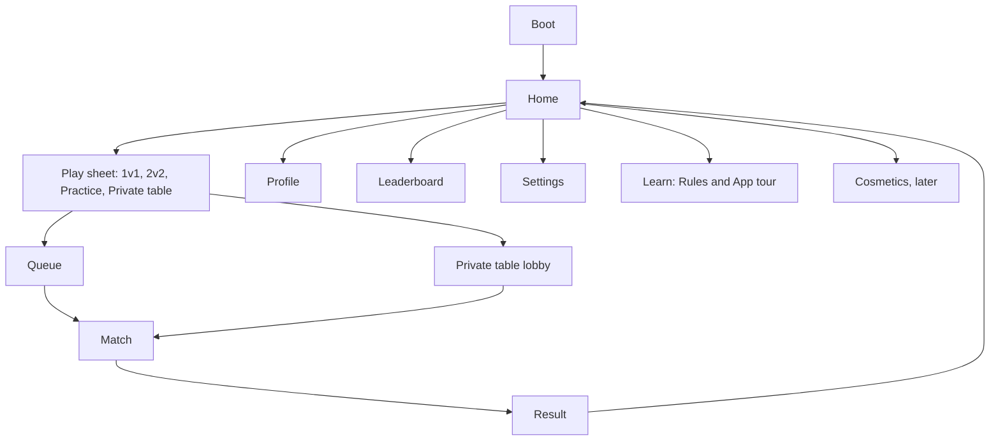

# 08 — Original UI/UX Design Specification

**Deliverable G.** · **Status:** PROPOSED · **Date:** 2026-11-12 · Decisions: D-U-01…D-U-10, D-C-03, D-P-04.
**Clean-room rule.** Phase 2 captures (`docs/reference_captures/`) are *research*. Nothing here traces, re-draws, colour-picks or mirrors a reference screen. §12 lists what we deliberately do differently; every screen is reviewed against that list.
**Tags.** VRO items cite Phase 2 evidence (Phase 2 `docs/04`, `docs/05` or `docs/02a` IDs); everything else is DD/PD.

---

## 1. UX principles

1. **Explain every point** (P1): any score change shows *why* (reason code → bubble → log).
2. **One obvious thing at a time:** the current turn, the current timer, the one legal primary action.
3. **Mistakes are cheap, not free:** two-step card play with capture preview, but no confirmation dialogs for routine actions.
4. **Respect interruption:** autopilot + reconnect + a visible, calm "you are away" overlay.
5. **RTL and low-end first:** layouts are authored for RTL and LTR; effects degrade gracefully.
6. **No dark patterns:** no forced interstitials, no fake urgency, no streak-loss pressure.

**VRO lessons applied.** Landscape-only and one-handed reach (U01); turn glow and a "cards this deck / points" scoreboard (R26); call-out bubbles for events (U07); an explanatory end-of-deck bubble (A021); a staged result with count-up (U08); a Tutorial split into "rules" and "app" paths (`017_*`, `019_*`); modals with one clear close affordance. **Observed weaknesses avoided:** a full-screen video ad right after the result (earlier series); an external social link that opens another app; no visible turn timer; a profile bar and a result bar that disagree (U09).

---

## 2. Art direction options (D-U-01 — owner chooses)

All three are original; none uses the reference's café-courtyard scene or teal felt.

| | **A. Starlit riad rooftop** (recommended) | **B. Zellige workshop** | **C. Souk lantern night** |
|---|---|---|---|
| Mood | calm, nocturnal, focused | bright, crafted, playful | warm, dense, atmospheric |
| Scene | a rooftop terrace under stars, paper-lantern glow, a low brass tea tray; table = ink-blue cloth with a zellige ribbon band | a tile-maker's bench in daylight; table = mosaic top | alley stall with copper lamps; table = dark leather with brass studs |
| Strengths | highest card contrast, least eye strain, clearly unlike the reference | friendly, easy light themes, strong geometric identity | rich textures |
| Risks | dark UIs need care for small Arabic text | lower card contrast on bright surfaces | busy backgrounds hurt legibility on small screens |
| Palette family | ink indigo, saffron, turquoise, terracotta, ivory | cobalt, emerald, ochre, terracotta, cream | amber, copper, oxblood, smoke, cream |

### 2.1 Colour tokens for Direction A (original, to be refined by the art lead; semantic names, values provisional)

| Token | Value | Use |
|---|---|---|
| `bg.night` | `#0F1830` | outside the table |
| `felt.base` / `felt.edge` | `#17254A` / `#0B1226` | table cloth (radial vignette) |
| `brand.saffron` | `#F2A93B` | primary actions, titles |
| `brand.turquoise` | `#2FB8B0` | secondary actions, "your turn" |
| `brand.terracotta` | `#C8553D` | danger/penalty, 2v2 accent |
| `surface.ivory` | `#F7EFDD` | panels, modals |
| `surface.sand` | `#E8D8B5` | tracks, secondary surfaces |
| `ink.primary` | `#1D2433` | text on ivory |
| `glow.star` | `#FFE9A8` | highlights, lantern glow |
| `state.go` / `state.warn` / `state.danger` | `#58C27D` / `#F2C14E` / `#E5533D` | status (never alone) |
| Suits (shape + colour) | coins `#E0A82E`, cups `#C8553D`, swords `#4A78C2`, clubs `#3F8F5B` | colour-blind-safe by distinct **shapes** |

Contrast requirements: body text ≥ 4.5:1, text on the felt ≥ 7:1, UI icons ≥ 3:1; state is never encoded by colour alone.

## 3. Design tokens

| Group | Spec |
|---|---|
| **Canvas** | reference 2400 × 1080 (20:9), scale by height; support 16:9 → 21:9 and tablets; safe-area insets honoured (cutouts) |
| **Spacing** | 8 dp grid; screen gutters 24 dp; dialog padding 24 dp |
| **Touch targets** | ≥ 48 × 48 dp; primary buttons ≥ 56 dp high |
| **Radius** | buttons 14, cards 10 (≈ 7 %), panels 20 |
| **Type scale** (reference px at 1080 high) | display 56 · title 40 · headline 32 · body 28 · caption 22 · numerals (score) 44; line height 1.25; max Arabic/Latin size parity within 1 step |
| **Fonts** | one rounded display family + one text family, each with Latin **and** Arabic coverage or a matched pair (D-A-03, doc 09 §6) |
| **Elevation** | no heavy shadows: 2 levels (surface, modal) with soft contact shadow |
| **Iconography** | 56 px grid, 4 px stroke, rounded caps, filled for state (lock, plus) |
| **Motion tokens** | `fast` 120 ms · `base` 220 ms · `slow` 400 ms · `flight` 280 ms ease-out · `count` 1200 ms · reduced-motion = cross-fade ≤ 120 ms |

## 4. Information architecture



Home exposes **one primary button ("Play")**; mode choice happens in a bottom sheet so first-time players are not confronted with four equal tiles (a deliberate difference from the reference's four-tile menu, U01).

## 5. Layout grid and safe areas

Landscape only. A 12-column grid inside the safe area; the match screen uses **five zones**: top bar (menu, scoreboard capsule, timers), opponent band, **table ribbon**, own hand, action bar (announce/catch/stickers). RTL swaps the order of menu-level groups; the **table does not mirror** (doc 06 §10).

---

## 6. Screen specifications

*Wireframes are structural; sizes in dp at 1080 reference height.*

### 6.1 Boot / splash
Logo on a night gradient; a thin progress line; version at the bottom corner; no developer credit screens longer than 1.5 s total. Errors: offline banner and "Play practice" button.

### 6.2 Home
```
┌────────────────────────────────────────────────────────────────────────┐
│ (avatar) name  ◐ Lv 4  ▓▓▓░░ XP         [Ladder] [Learn]  [⚙ Settings] │
│                                                                        │
│          scene: rooftop, lantern, tea tray (parallax, 1 layer)          │
│                       ┌────────────────────┐                           │
│                       │   ▶  PLAY          │   (primary, saffron)      │
│                       └────────────────────┘                           │
│   [Practice]                                           [Cosmetics ·later]│
└────────────────────────────────────────────────────────────────────────┘
```
**Play** opens a bottom sheet: *Quick match 1v1 · Quick match 2v2 · Private table · Practice*. Join-by-code is inside *Private table*.

### 6.3 Queue
Modal over the scene: two portraits (you / a quiet "searching" silhouette), "Finding a worthy opponent…" + elapsed timer, **Cancel**. After the casual bot-fill threshold: "No opponent yet — play a practice partner now?" with Accept / keep waiting (D-S-08). Ranked shows the rating window only after a delay.

### 6.4 Private table lobby
Seat slots in two team halves (1v1: two seats; 2v2: four), a large **table code** with copy/share, a clear lock/open state per seat, host **Start** (disabled until ready), spectator count (post-beta), settings chip (timer, target). *(VRO: the reference has a waiting room with seat slots, a code and a spectator counter — U04 visual. Our layout, naming and visuals are our own.)*

### 6.5 Match screen (1v1)

```
┌────────────────────────────────────────────────────────────────────────┐
│ [☰]            ┌ YOU 12 · cards 14 ┐ ┌ RIVAL 20 · cards 13 ┐   [⏱ ring] │ top bar: menu, score capsule
│            ( rival portrait )  ◔ turn ring   deck 24 ▭               │ opponent band
│                                                                        │
│    ╭─ 1 ─ 2 ─ 3 ─ 4 ─ 5 ─ 6 ─ 7 ─╌─ 10 ─ 11 ─ 12 ─╮   RANK RIBBON    │ 10 sockets, curved
│    ╰────────────────────────────────────────────╯   (7→10 gap mark)   │
│                                                                        │
│  (you)           ╱▔▔╲ ╱▔▔╲ ╱▔▔╲ ╱▔▔╲  hand (fan)       [Ronda!] [🎯] [😀] │ action bar
└────────────────────────────────────────────────────────────────────────┘
```
- **Rank ribbon (D-U-03):** ten sockets in one curved row, each labelled with its rank in the active numeral set; a small ornament between 7 and 10 marks the jump. A captured chain highlights consecutive sockets in order.
- **Score capsule:** own side first (reading direction), two lines: **points** (large) and **cards this deck**; tapping expands the score log.
- **Deck counter** near the dealer's portrait; **dealer token** on the dealer's portrait.
- **Turn:** the active portrait gets a **turn ring that doubles as the timer** (drains over `turnTimerMs`); in the last 5 s the ring pulses and a soft tick plays; it is shape + motion + sound, never colour alone.
- **Announcement banner** below the capsule: "Announce a Ronda · 11 s" with a draining bar, visible only at deals where the player holds a pair or more *and* the window is open.

### 6.6 Match screen (2v2)
Four portraits: you bottom, partner top, opponents left/right; the ribbon stays central; the score capsule shows teams ("We / They" in the UI language); partner and opponent portraits show presence badges. Shared pile counts per team.

### 6.7 Result and tally
1. **Tally steps** (each ~0.6 s, skippable): *Leftover → "Last capture: You"* · *Dealer rule* · *Cards over 20 (e.g. 32 → +12)*, with the running score.
2. **Result panel:** Victory/Defeat, final score, itemised breakdown (Missa ×n, Derba ×n, Ronda/Tringla, Catch, tally), rating and XP deltas with a **count-up (≈ 1.2 s)**, tier progress.
3. Buttons: **Rematch**, **Home**, **Review** (replay), **Report**. No interstitial.
*(VRO: the reference's result panel counts up XP/rank (A044 → A045, U08 visual); the end-of-deck bubble explains +5 and +12 (A021). We make the tally a first-class, skippable sequence.)*

### 6.8 Profile
Avatar + frame, display name, level and XP, rating and tier per mode, stats (played, won, win ratio, longest chain, Missas…), recent matches, public id with copy, avatar/frame picker (≥ 16 portraits, 4-column grid, explicit **Save**).

### 6.9 Leaderboard
Per mode/season; top 3 emphasised; **own row pinned**; friends filter later. Columns: rank, player, tier, rating, win ratio.

### 6.10 Settings
Language (5), sound (music/SFX sliders — VRO had one toggle, U01), haptics, **card play: two-step / quick**, reduced motion, high-contrast suits, text size, numerals (Western/Arabic-Indic), notifications, privacy & data (export/delete, analytics consent), account (link, sign out), version.

### 6.11 Learn
**Rules** (~25 interactive steps) and **App tour** (~15 steps) led by the original mascot (D-U-02); skippable; resumable; shows rule text from the same localisation tables as the game.

### 6.12 Overlays
| Overlay | Content |
|---|---|
| **Away (autopilot)** | calm modal: "A helper is playing for you" + **I'm back**; table visible behind (VRO R30, A020 visual) |
| **Reconnecting** | non-blocking banner with spinner and a countdown to the grace limit; after resume a "Back in the game" toast |
| **Announce** | contextual **Ronda / Tringla** button appears beside the hand only when eligible; tap to announce (no extra confirm); shows "Sealed ✓" |
| **Catch picker** | long-press a rival portrait → bottom picker with the 10 ranks (only ranks that rival has played this deal are enabled, per the evidence rule) → **Confirm**; result toast "Caught! +1" or "Not this time — locked until next deal" |
| **Stickers** | tray of ≈ 24; rate-limited; per-player mute from the portrait menu |
| **Match menu** | rules reference, settings, leave (with a clear consequence text in ranked) |
| **Errors** | friendly, localised, never raw codes; "update required" screen with a store link |

---

## 7. Interaction specification

### 7.1 Playing a card (D-U-04)
1. Tap a card → it **lifts** (120 ms) and the ribbon **previews the capture** (sockets that would be taken glow in chain order; a drop shows the target socket as a dashed outline).
2. Tap the lifted card again (or swipe it up) → `PlayCard` is sent; the card flies only when `CardPlayed` returns (never optimistic).
3. Tap elsewhere → cancel. **Quick play** (setting): one tap plays.
4. During `Animating` or when it is not your turn the hand is inert (soft shake, no error text).

### 7.2 Announce, catch, away
Announce: one tap, instant "Sealed ✓", no confirm. Catch: long-press portrait → picker → confirm. Away: any tap on **I'm back** (the next own turn is yours again). Haptics: light on lift, medium on play, success pulse on Missa/Derba/Catch (settings toggle).

### 7.3 Timers
Turn ring drains over the turn limit; announcement banner shows seconds; reconnect banner shows the remaining grace. All countdowns follow server deadlines (doc 06 §8).

## 8. Motion specification

| Motion | Duration / easing | Reduced-motion variant |
|---|---|---|
| Card lift / cancel | 120 ms ease-out | instant |
| Card flight to socket or capture | 280 ms ease-out + 40 ms settle | 120 ms fade-move |
| Capture sweep to the pile | 350 ms, chain cards staggered 90 ms | simultaneous 150 ms |
| Chain highlight | 90 ms per socket | single highlight |
| Missa burst | 700 ms particle + bubble | bubble only |
| Derba flash | 400 ms ring + bubble | bubble only |
| Score tick | 300 ms count | instant |
| Call-out bubble | pop 160 ms, hold 1.6 s, fade 200 ms | fade only |
| Announcement reveal | flip 250 ms per card, stagger 120 ms | instant swap |
| Turn ring | continuous drain; last 5 s pulse 1 Hz | no pulse (sound cue stays) |
| Tally row | 600 ms per row | 200 ms |
| Result count-up | 1200 ms ease-out | instant |
| Screen transitions | 220 ms fade/slide | fade 120 ms |

Durations are targets; presentation fast-forwards when behind (doc 06 §5).

## 9. Language, tone and copy

- **Languages:** EN, FR, AR (MSA), then Darija and ES (D-P-04). All strings from localisation tables, never hard-coded; **pseudo-localisation** (+40 % length, accented, RTL test strings) in CI.
- **Tone:** warm, concise, respectful; the mascot may use light Darija greetings in Darija locale only; no jokes at the expense of losing players.
- **Examples (EN):** "Your turn" · "You took 7, 10 and 11 — Missa! +1" · "The dealer wasn't the last to take: +5 to the other side" · "Not this time — you can catch again next deal."
- **Terminology:** Ronda, Tringla, Missa, Derba kept as game words with a one-line glossary; "Catch" localised.
- **Errors:** no codes shown; a short cause and a next step; "Report a problem" attaches the match recorder export.

## 10. Accessibility (D-U-08)

| Area | Requirement |
|---|---|
| Colour | suits distinguishable by **shape** and colour; high-contrast mode; no colour-only states |
| Text | 100–150 % scaling without clipping; minimum 22 px caption at reference |
| Motion | reduced-motion setting; no flashes > 3 Hz |
| Input | one-handed reach for primary actions; large targets; haptics optional |
| Screen reader | card/button labels ("Seven of swords", "Announce Ronda"), live-region announcements for turn changes and score events |
| Timers | audio cue in addition to visual; private tables may extend timers |
| RTL | mirrored menus, correct bidi in mixed text, numerals per setting |
| Photosensitivity | particles capped; glow pulses ≤ 1 Hz |

## 11. Review checklist — original and clean-room (apply to every screen and asset)

- [ ] Composition is ours (no mirrored layout of any reference screen).
- [ ] No reference colours picked from captures; palette from our tokens.
- [ ] No reference icons, mascot, card faces/backs, avatars, fonts, sounds or strings.
- [ ] Mascot differs in species/character, outfit, silhouette and name.
- [ ] Table composition differs (rank ribbon, not a 5 × 2 grid).
- [ ] Wording is ours (do not paraphrase the Tutorial closely).
- [ ] Reviewed side-by-side by someone who did not make it; "too close" findings are fixed.
- [ ] Reference screenshots never imported into Unity.

## 12. Deliberate differences from the reference (summary)

| Area | Reference (VRO) | Ours |
|---|---|---|
| Scene and palette | café courtyard, teal felt, wood octagon | rooftop night (A), ink-blue cloth, zellige ribbon |
| Home | four equal mode tiles | one primary **Play** + sheet |
| Table | 5 × 2 rank grid | single curved rank ribbon |
| Scoreboard | top-right two-row board | top-centre capsule with expandable log |
| Card play | one tap | two-step with capture preview (quick-play optional) |
| Timer | none visible (value UNKNOWN) | visible ring + cue |
| Tutorial mascot | a jack-of-the-deck character | original tea-pot guide |
| After a match | full-screen video ad then menu (earlier series) | itemised tally, rematch, no interstitial |
| Social link | opens another app | system browser with label |
| Naming | reference brand and tier names | our name (D-P-01) and tiers (doc 02 §8) |
| Announcements | revealed after the window; credit timing unknown | sealed, resolved once, explained |
