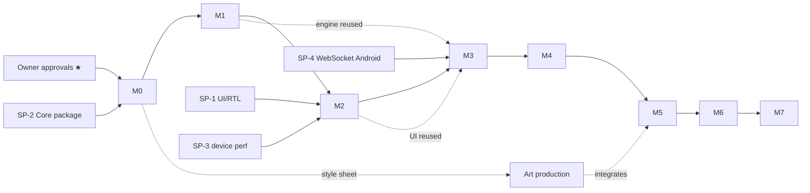

# 11 — Phased Implementation Roadmap

**Deliverable J.** · **Status:** PROPOSED · **Date:** 2026-11-12
**Gate.** **No implementation starts until the owner approves the ★ decisions** (`01_decision_register.md` §4). M0 is the first milestone after that approval. Calendar dates are not given: team size and budget are unknown (OQ D-P-07). Durations below are **relative planning figures** assuming a team of 3–4 working in parallel (a rules/server engineer, a Unity engineer, a UX/UI + art lead, QA part-time); they change with the answer to D-P-07.

---

## 1. Milestone overview

| M | Name | Goal | Rel. duration | Key outputs | Exit gate |
|---|---|---|--:|---|---|
| **M0** | Foundations and approvals | decisions approved; repo, CI, licence policy, art style sheet; SP-2 | 2 wk | monorepo skeleton, `dotnet test` CI, provenance register, Unity LTS installed (approved), style sheet commissioned | ★ approvals recorded; SP-2 pass; fallback (B/C) decision made |
| **M1** | Rules engine | full ruleset R1 in `Ronda.Core`, bots, simulator | 4 wk | engine + flags, legal moves, golden vectors, property tests, `Ronda.Simulation`, Easy/Normal bots | AC-01…10 green; 1M-game runs clean; coverage targets; A/B reports for D-G-07/13 |
| **M2** | Offline vertical slice | playable 1v1 vs bots in Unity with placeholder art | 6 wk | bootstrap, match UI, rank ribbon, two-step play, choreographer, score explanations, l10n + RTL infrastructure, settings; SP-1, SP-3 | AC-17…20, 24; playtest 1; D-C-03, D-C-11, D-U-03/04 confirmed |
| **M3** | Online alpha | authoritative 1v1 online | 6 wk | gateway, rooms, protocol, auth (guest + IdP), Postgres/Redis, reconnect, autopilot, server bots, observability; SP-4 | AC-11…13, 15; load 500 matches; chaos pass |
| **M4** | Ranked and social | matchmaking, ratings, profiles, private tables | 5 wk | queues, Glicko-2, leaderboards, profile UI, private tables, bot-fill policy, anti-abuse baseline, replay review | AC-14, 16; closed alpha with friends; playtest 2 |
| **M5** | 2v2 and full experience | 2v2 online, tutorial, final art/audio | 6 wk | 2v2 rules online, party/partner assignment, tutorial (both paths), stickers/mute/report, final UI kit, audio, EN/FR/AR | content-complete beta; AC-22, 23; playtest 3 |
| **M6** | Hardening and polish | performance, security, accessibility, locales | 6 wk | perf pass, pen test, accessibility audit, Darija + ES, store assets, privacy/legal, dashboards | release-candidate criteria (§5); closed beta |
| **M7** | Soft launch → release | staged rollout and live operations | 4 wk + ongoing | staged rollout, monitoring, balancing, hotfix path, post-launch backlog | KPIs met (doc 02 §13); no S1/S2 |

*Planning total ≈ 39 weeks with the assumed team; treat as an order of magnitude until D-P-07 is answered and M0/M1 velocity is measured.*

## 2. Dependency and critical path

**Critical path:** approvals → M0 → M1 → M2 → M3. Art production and localisation run in parallel from M0/M2 and join at M5. The server (M3) cannot start before the engine is stable (M1); the online client reuses the M2 match UI through the `IMatchGateway` port (doc 06 §4), which is why M2's offline slice is not throw-away work.

## 3. Milestone detail

### M0 — Foundations and approvals
- **Scope:** record approved decisions in the register; create the monorepo layout (doc 06 §3); CI for `dotnet test`; licence/provenance policy; install Unity 6.3 LTS and the Android module (**approval needed**); commission the art style sheet for the chosen direction (D-U-01, D-A-01); **SP-2**.
- **Decision points:** D-C-01, D-S-02 fallback decision (using the D-P-07 answer), D-A-01, D-U-01.
- **Risks:** ownership of art sourcing unclear → block art; Unity install delays → use the installed editor temporarily.

### M1 — Rules engine
- **Scope:** `Ronda.Core` (doc 05): value objects, `MatchState`, `Apply`, commands/events, ruleset + flags (doc 03 §13), shuffler with independent verification, legal-move generator, scoring, tally, presence/timer inputs, view projection with redaction; `Ronda.Bots` (Easy, Normal) and `AutopilotPolicy`; `Ronda.Simulation` CLI; all golden vectors and property tests (doc 10).
- **Decision inputs produced:** simulation reports for D-G-07 (mustCapture), D-G-13, D-G-11 variants.
- **Risks:** rule ambiguities surface late → keep flags; floating point or time leaking into Core → analyzers and the determinism tests.

### M2 — Offline vertical slice
- **Scope:** Unity bootstrap and composition root; `LocalMatchGateway`; match screen with rank ribbon (flat placeholders); two-step play with capture preview; choreographer and fast-forward; score bubbles/log; settings; localisation infrastructure with pseudo-locale and an Arabic screen; performance harness on the target phone; **SP-1, SP-3**.
- **Risks:** UI Toolkit + Arabic issues → fallback uGUI (D-C-03); low-end performance → atlas/draw-call work early.

### M3 — Online alpha
- **Scope:** protocol v1 (doc 07 §5), gateway, match-room actors, timers, autopilot and server-side bots, event log + snapshots, guest + managed IdP auth, reconnect/resume, observability, rate limits, redaction tests; client `OnlineMatchGateway`; **SP-4**; hosting provider chosen (D-S-03) and environments created (**approval**).
- **Risks:** WebSocket behaviour on Android; hosting latency to the Maghreb → measured in alpha; UGS/Nakama fallback only if M0 decided so.

### M4 — Ranked and social
- **Scope:** matchmaker, Glicko-2 ratings, leaderboards, profile and avatar UI, private tables with codes, casual bot fill, anti-abuse baseline, replay review, account linking, closed alpha.
- **Risks:** queue liquidity → bot fill/private tables; rating tuning → shadow ratings in alpha.

### M5 — 2v2 and the full experience
- **Scope:** 2v2 online (seat/partner assignment, parties, side-level rules), tutorial (rules + app tour) with the original mascot, stickers/mute/report, final UI kit and art integration, audio, EN/FR/AR localisation.
- **Risks:** 2v2 collusion → heuristics and replay review; tutorial scope → cut the app tour to the essentials first.

### M6 — Hardening and polish
- **Scope:** performance/thermal pass, post-match memory gate, security review and external pen test, accessibility audit, Darija and Spanish, store assets, privacy/legal review (D-P-05), telemetry dashboards, chaos and load re-runs, closed beta (50–200).
- **Risks:** late legal findings → start review in M5; store policy changes.

### M7 — Soft launch and release
- **Scope:** staged rollout (countries/percentages), monitoring and alerts, balancing, hotfix process, post-launch backlog: spectators, derba escalation variant (D-G-21), cosmetics store (after D-P-03), clubs/tournaments.

## 4. Decision deadlines (from the register)

| By | Decisions |
|---|---|
| **Before M0** | all ★ approvals; D-P-07 answer |
| **M0** | D-P-01 (codename), D-P-02, D-P-06, D-S-01, D-S-02, D-C-01, D-C-04, D-U-01, D-A-01 |
| **M1** | D-G-01…D-G-20 confirmed after simulation reports (D-G-06/07/10/11/13 especially) |
| **M2** | D-C-02, D-C-03 (SP-1), D-C-05…D-C-12, D-U-03, D-U-04, D-U-10, D-P-04, D-A-03, D-A-04 |
| **M3** | D-G-17, D-S-03…D-S-06, D-S-08, D-S-09, D-S-11…D-S-13, D-P-05 |
| **M4** | D-S-07, D-S-10, D-G-02 (private/ranked scope) |
| **M5** | D-P-03 (monetisation), D-G-18, D-U-09, D-A-02 |
| **M6** | D-P-01 (final name, trademark search) |

## 5. Release-candidate criteria (M6 exit)

No open S1/S2 defects; all AC-nn green including AC-16 (load), AC-20/21 (performance and memory), AC-22 (accessibility); privacy and legal sign-off; store listing complete in all launch languages; crash-free sessions ≥ 99.5 % in the closed beta; reconnect success ≥ 98 %; documented rollback plan.

## 6. Risk register (top items)

| # | Risk | L | I | Mitigation | Owner/When |
|---|---|:-:|:-:|---|---|
| 1 | Unknown reference behaviours cause rule disputes | M | M | flags + playtests + optional observation session | M1–M2 |
| 2 | UI Toolkit/Arabic limitations | M | H | SP-1, fallback uGUI | M2 |
| 3 | Low-end performance and memory | M | H | budgets, SP-3, post-match gate | M2, M6 |
| 4 | Backend choice wrong for the team | M | H | D-P-07 early; fallback B/C decided at M0 | M0 |
| 5 | Art direction/sourcing delays or legal similarity concerns | M | H | style sheet in M0, provenance register, review checklist | M0–M5 |
| 6 | Matchmaking liquidity | H | M | bot fill (casual), private tables, wide windows | M4 |
| 7 | 2v2 collusion | M | M | no free chat, heuristics, replay review | M5 |
| 8 | Scope creep (spectators, escalations, cosmetics) | H | M | milestone gates; post-launch backlog | all |
| 9 | Privacy/compliance (minors, data residency) | M | H | early counsel review; consent design | M5–M6 |
| 10 | Vendor/roadmap shifts (cf. Multiplay Hosting deprecation, 2026) | L | M | own the core; thin adapters for identity/hosting | all |

## 7. Relationship to the original phase plan

The brief's later phases (architecture, asset plan, roadmap, final review) are covered at the owner's request by docs 06–11. After the owner approves the register, a short **final review** (consistency pass across docs 01–11, updated register statuses) closes Phase 3, and **M0** starts implementation. Nothing in this roadmap authorises installs, accounts or spending; each such step is requested individually.
