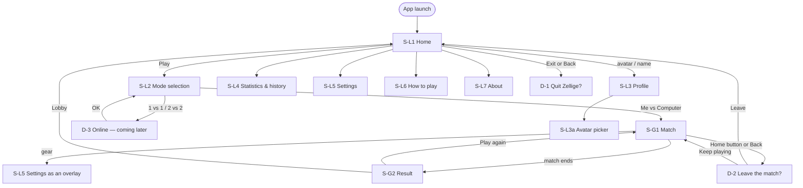

# Product 02 — Lobby Specification

**Status:** PROPOSED. Not approved, not implemented. · **Date:** 2026-11-17
**Decisions:** `01_product_decisions.md` (D-L-01…D-L-20, D-O-01). Defaults that need the owner's approval are marked ★. If a ★ decision is revised, the matching section here changes.
**Constraints:**
- Unity 2022.3, Built-in RP, uGUI + TextMeshPro, legacy input (OB-1).
- No networking, backend or accounts in this milestone (OB-4).
- Game rules unchanged (D-L-20).
- Original assets only.

---

## 1. Goals

1. The app opens on a Lobby that feels like part of Zellige. It does not drop the player straight into a match (D-L-01).
2. Me vs Computer plays **exactly** as the current MVP does: same engine, same rules, same AI, same match screen.
3. The player has a local identity (name, avatar), sees their results, can change settings, read the rules and quit cleanly. None of this needs an account.
4. 1 vs 1 and 2 vs 2 are visible as the product direction but cannot be started (D-L-02 ★).
5. Every navigation path works with touch and with Android Back.

**Non-goals for this milestone:**
- online play, accounts, matchmaking, rooms, invitations;
- XP, levels, tiers, leaderboards;
- shops, ads;
- interactive tutorial;
- languages other than English;
- music;
- rule options;
- resuming interrupted matches.

---

## 2. Feature inventory: what exists, what can be reused, what is new

| Area | Already implemented | Reusable component | New work |
|---|---|---|---|
| Me vs Computer match | Full match: engine, Nadia, events, animations, result | `Game.unity`, `GameController`, `GameScreen`, `SimpleAi`, `RondaGame` | Read the `MatchRequest`; record the result |
| Restart | "New game" (top bar), "Play again" (result) | `GameController.StartNewMatch` | none |
| Return to lobby | — | — | "Lobby" on the result overlay; in-match "Home"; leave confirmation |
| Quit confirmation | `QuitDialog` (Back → "Quit Zellige?") | `QuitDialog.Build(root)`, its overlay and buttons | Make its title, message and button texts configurable; place it in the Lobby |
| Sound setting | Mute toggle in the match top bar (not saved) | `SoundFx.Muted`, `icon_sound_on/off` | Persisted setting, shared by the lobby and the match |
| Profile | Two avatar images (`avatar_01`, `avatar_02`), avatar frame | `frame_avatar`, `UiKit` | Profile model, storage, screen, avatar picker; more avatars (asset request) |
| Statistics / history | — | — | Model, recorder, storage, screen |
| Settings screen | — | `UiKit` widgets, panel sprites | Screen + storage |
| Rules / tutorial | — (rules exist only in docs) | `docs/mvp/01` as the source | Static paged "How to play" (new text, our own words) |
| About / credits | — | — | Screen |
| Exit | `QuitDialog` | same | Entry on Home |
| UI kit | `UiKit` (palette, 9-slice panels, buttons, outlined TMP labels), editor-authored UI pattern (`GameUiBuilder`) | `UiKit`, the builder pattern | `LobbyUiBuilder` (authors `Lobby.unity`) |
| Responsive layout | Canvas Scaler 1920 × 1080, Expand; QA at 16:9, 20:9, 4:3 | same settings | Same QA for lobby screens |

---

## 3. Screens and navigation

### 3.1 Screen list

| ID | Screen | Type | Purpose |
|---|---|---|---|
| S-L1 | **Home** | Lobby root | Identity, Play, access to everything else |
| S-L2 | **Mode selection** | Lobby screen | Me vs Computer · 1 vs 1 Online (locked) · 2 vs 2 Online (locked) |
| S-L3 | **Profile** | Lobby screen | Name, avatar, summary stats |
| S-L3a | Avatar picker | Dialog over S-L3 | Choose an avatar, then Save |
| S-L4 | **Statistics & history** | Lobby screen | Me vs Computer totals and the last 20 matches |
| S-L5 | **Settings** | Lobby screen (also reachable from the match) | Sound, card play mode, language (display only), version |
| S-L6 | **How to play** | Lobby screen, paged | Rules in our own words |
| S-L7 | **About** | Lobby screen | Credits, version, notices |
| D-1 | **Quit Zellige?** | Dialog (existing) | Exit the app |
| D-2 | **Leave the match?** | Dialog in the match (new text, same component) ★ | Back to the lobby |
| D-3 | **Online — coming later** | Dialog | Explains the locked modes |
| S-G1 | **Match** | `Game.unity` (existing) | Unchanged gameplay; adds Home and Settings access |
| S-G2 | **Result overlay** | in `Game.unity` (existing) | Adds a **Lobby** button next to **Play again** |

### 3.2 Navigation map



### 3.3 Android Back behaviour (D-L-08 ★)

| Where | Back does | Notes |
|---|---|---|
| Home, no dialog open | Opens **Quit Zellige?** | Same text and buttons as OB-2 |
| Quit Zellige? open | Closes it (= Cancel) | Unchanged from M2 |
| Any lobby screen (S-L2…S-L7) | Returns to Home | Screens are one level deep, except the avatar picker |
| Avatar picker | Closes the picker without saving | |
| D-3 Online — coming later | Closes it | |
| Match, no dialog | Opens **Leave the match?** ★ | Replaces today's quit prompt in the match |
| Leave the match? open | Closes it (= Keep playing) | |
| Settings overlay in the match | Closes the overlay | |
| Result overlay | Goes to the Lobby | Same as the Lobby button |
| During scene loading | Ignored | No double navigation |

One rule throughout: **Back always undoes the most recent navigation step, and never destroys progress without a confirmation.**

---

## 4. Screen specifications

All layouts are landscape. The reference canvas is 1920 × 1080 with the Expand scaler. Touch targets are at least 96 px at the reference size (≈ 48 dp). Important content stays inside the safe area. Wireframes are structural only; they are not visual designs.

### 4.1 S-L1 Home

```
┌──────────────────────────────────────────────────────────────────────────┐
│ (avatar) Player name ›                                   [⚙ Settings]   │
│                                                                          │
│                      Z E L L I G E   (word mark)                         │
│                     ── geometric zellige band ──                         │
│                                                                          │
│                        ┌──────────────────────┐                          │
│                        │        PLAY          │   primary (gold/orange)  │
│                        └──────────────────────┘                          │
│                                                                          │
│  [▦ Statistics]   [📖 How to play]   [ⓘ About]                  [⏻ Exit] │
└──────────────────────────────────────────────────────────────────────────┘
```

- **Profile chip** (top-left): avatar in `frame_avatar` and the display name. Tapping opens S-L3.
- **Play** opens S-L2.
- **Secondary row:** Statistics (S-L4), How to play (S-L6), About (S-L7). **Exit** sits in the bottom-right corner and opens D-1.
- **Settings** (top-right, reuses `icon_settings`) opens S-L5.
- **First launch:** the profile is created silently with the name "Player" and the first avatar. A one-time hint bubble near the chip says "Tap to set your name". There is no blocking form (D-L-10).

### 4.2 S-L2 Mode selection

```
┌──────────────────────────────────────────────────────────────────────────┐
│ [‹ Back]                      Choose a game                              │
│                                                                          │
│   ┌──────────────┐     ┌──────────────┐     ┌──────────────┐             │
│   │  You  vs     │     │  1 vs 1      │     │  2 vs 2      │             │
│   │  Computer    │     │  ONLINE      │     │  ONLINE      │             │
│   │  (Nadia)     │     │  🔒 coming   │     │  🔒 coming   │             │
│   │  ▶ Play      │     │     later    │     │     later    │             │
│   └──────────────┘     └──────────────┘     └──────────────┘             │
│   First to 41 points · offline                                           │
└──────────────────────────────────────────────────────────────────────────┘
```

**Me vs Computer**
- Builds a `MatchRequest { Mode = VsComputer, Opponent = "Nadia", Rules = default }` and loads `Game.unity`.
- One tap starts the match. There is no options screen, because there are no rule options (D-L-20) and only one AI level.

**1 vs 1 Online and 2 vs 2 Online (D-L-02 ★)**
- Shown locked, and tapping one opens D-3: *"Online play is planned for a later version. For now, play against Nadia."*
- The app makes **no network calls**.
- If the owner chooses option (a) in D-L-02, these two cards are hidden instead.

**Order and wording** follow the owner's names: "Me vs Computer", "1 vs 1", "2 vs 2".

### 4.3 S-L3 Profile and S-L3a Avatar picker

- **Fields:** the avatar (tap to change), the display name (tap to edit with TMP's input field, which uses the Android keyboard), and a summary taken from S-L4: matches played, win %.
- **Name validation:**
  - trimmed, 1–16 characters;
  - letters, digits, spaces and `- _ .` only;
  - an empty or invalid entry keeps the previous name and shows an inline message.
  - There is no profanity filter: the name is local and never shared (online names come later, D-O-04).
- **Avatar picker:** a grid (4 columns) of the bundled avatars. The current one is highlighted. **Save** and **Cancel**. Today only 2 avatar images exist, so a set of about 8 original avatars is an asset request (D-L-17 ★). Until then the picker shows the two available images.
- **Account wording:** the profile says "Saved on this device", so that nobody expects it to sync.

### 4.4 S-L4 Statistics & history (D-L-11)

- **Totals (Me vs Computer):**
  - played, won, lost, abandoned;
  - win % = won ÷ (won + lost), so abandoned matches are excluded; shown as "—" before the first completed match;
  - best winning margin; highest final score.
- **History:** the last 20 matches, newest first. Each entry has date and time (device local), mode, opponent, final score "You 41 – 27 Nadia", result (Win / Loss / Abandoned) and the number of decks played.
- **Empty state:** "No matches yet. Play your first game against Nadia." with a **Play** button that goes to S-L2.
- **Reset statistics:** a button with a confirmation dialog. Owner choice; recommended yes.
- Online statistics will appear later in **separate** sections, never merged (D-O-13).

### 4.5 S-L5 Settings (D-L-13)

| Setting | Values | Default | Applies to | Notes |
|---|---|---|---|---|
| Sound effects | On / Off | On | Lobby and match | Same switch as the match top-bar toggle; both read and write one stored value |
| Card play | Two-step (preview then play) / Quick play (one tap plays) | Two-step | Match | D-U-04 option. Quick play changes only the input step; rules unchanged |
| Language | English | English | — | Shown, not selectable, until D-P-04 is planned (★ D-L-13) |
| Version | read-only | — | — | `Application.version` |

- **Not offered, with reasons:**
  - music: there are no music assets;
  - AI difficulty: there is one AI;
  - rule variants: these would change gameplay (D-L-20);
  - "confirm before quit": the confirmation is always on;
  - notifications, accounts, privacy: there is no online feature yet.
- **In the match:** Settings opens as an overlay from the top bar. The match keeps running underneath, because the Me vs Computer game has no timer, so it simply waits.

### 4.6 S-L6 How to play (D-L-14 ★)

- About 8 pages, each with a short text, a small illustration made from existing card sprites, and **Previous / Next / Close** buttons. Topics:
  1. the deck and rank order (no 8/9; 7 → 10);
  2. playing a card, capture, the chain;
  3. Missa and Derba;
  4. Ronda and Tringla, how to announce them, the 40-point cap;
  5. the end of the deck: leftover, dealer +5, cards over 20;
  6. winning at 41;
  7. "In this version" (Catch is not available; house rules marked).
- **Text** is written by us from `docs/mvp/01` CONFIRMED rules. It must not paraphrase the reference tutorial (clean-room, phase3/08 §11). The owner reviews it before release.
- **Provisional rules** that the game applies (e.g. who plays first, M-11/H-1) are labelled "house rule in this version".

### 4.7 S-L7 About

The game name and version, "An original Moroccan Ronda card game", credits (team; the owner fills these in), and third-party notices (TextMeshPro and its LiberationSans font licence, Unity). The page also carries a short clean-room statement. There are no external links (doc 02 §9 lesson: no unexpected app hand-offs).

### 4.8 Match screen changes (S-G1, S-G2)

- **Top bar:**
  - existing: sound toggle, **New game**;
  - add: **Home** (house icon, opens D-2) and **Settings** (opens the S-L5 overlay).
  - Whether *New game* also asks for confirmation mid-match is an owner choice; recommended yes, with the same dialog component.
- **Result overlay:** **Play again** (existing) and **Lobby** (new).
- **Human nameplate:** the profile name and avatar. Nadia unchanged (D-L-19).
- **Nothing else changes:** cards, table, animations, rules and AI behaviour stay the same.

---

## 5. Data kept on the device

| Data | Fields | Written when | Size |
|---|---|---|---|
| Profile | `schemaVersion`, `displayName`, `avatarId`, `createdUtc` | first launch; on Save | < 1 KB |
| Settings | `schemaVersion`, `soundOn`, `quickPlay` | on change | < 1 KB |
| Stats | `schemaVersion`, the totals of §4.4, `history[≤20]` | at match end or on abandon | < 10 KB |

- Stored as JSON in `Application.persistentDataPath` (see the plan for the exact mechanism).
- **Corrupt or unknown data:** fall back to defaults, keep a `.bak` copy, never crash.
- **No personal data leaves the device.** Uninstalling removes it.
- **Changing `productName`** (D-L-18) changes this path, so it is fixed before release.

---

## 6. Functional requirements

| ID | Requirement |
|---|---|
| FR-01 | On launch the app shows S-L1 Home. The first frame is the Lobby; no match starts in the background. |
| FR-02 | Play → Me vs Computer starts a match whose rules, dealing, AI and scoring are identical to the current MVP (same `RulesConfig` defaults, same `SimpleAi`). |
| FR-03 | `Game.unity` opened directly in the Editor (no lobby before it) still starts a Me vs Computer match exactly as today. |
| FR-04 | When a match ends, its result is recorded in local stats **exactly once**: Play again, Lobby, or quitting from the result must not double-count it. |
| FR-05 | Leaving a running match through D-2 records one *abandoned* entry and returns to Home. Killing the app mid-match records nothing (v1 limitation, D-L-09 ★). |
| FR-06 | The Result overlay offers Play again (same mode, new shuffle) and Lobby. |
| FR-07 | Android Back follows §3.3 on every screen. |
| FR-08 | 1 vs 1 / 2 vs 2 never start network activity, never load `Game.unity`, and show D-3 (or are hidden, per D-L-02). |
| FR-09 | Profile name and avatar persist across app restarts. Invalid names are refused with a message. |
| FR-10 | Settings persist across restarts. The sound setting is honoured by the lobby and the match, and the match toggle and the Settings screen always agree. |
| FR-11 | Quick play, when on, plays a card with a single tap. Two-step (default) is unchanged. In both modes only legal cards can be played. |
| FR-12 | Statistics show correct totals and the last 20 matches newest first. Reset requires confirmation. |
| FR-13 | All lobby screens are laid out correctly at 16:9, 20:9 and 4:3, with no clipped text or overlapping controls (same QA bar as the match). |
| FR-14 | Missing or corrupt saved data never crashes the app; defaults are used. |
| FR-15 | All user-visible lobby strings come from one string table (English), ready for later localisation. |

## 7. Acceptance criteria

| AC | Given / when / then | Verified by |
|---|---|---|
| AC-L-01 | **Given** a fresh install, **when** the app starts, **then** Home shows "Player" with the default avatar, and no dialog blocks it. | Device and Editor manual check |
| AC-L-02 | **When** the player taps Play → Me vs Computer, **then** a match starts. All 175 existing EditMode tests still pass and the golden-master fingerprints are unchanged. | Test run (unchanged suite) |
| AC-L-03 | **When** a match is won (or lost) and the player taps Lobby, **then** Home is shown, and Statistics shows played +1 and won (or lost) +1, with one new history entry carrying the final score shown on the result overlay. | EditMode test of the recorder plus a manual run |
| AC-L-04 | **When** the player taps Play again after a result, **then** the new match starts and the first result is not counted twice. | EditMode test |
| AC-L-05 | **When** the player leaves mid-match via Home → Leave, **then** Home is shown and abandoned +1, while won and lost are unchanged. **When** they choose Keep playing instead, **then** the match continues from the same state. | Manual run plus a recorder test |
| AC-L-06 | Each row of the §3.3 Back table behaves as written, on an Android device. | Device checklist (**not claimed until a device test is done**) |
| AC-L-07 | **When** sound is set Off in Settings and a match is started, **then** it is silent, the match toggle shows Off, and after a restart it is still Off. | Manual run plus a settings round-trip test |
| AC-L-08 | **When** the name is set to "Yassine" and the app is restarted, **then** Home and the match nameplate show "Yassine". Names of "" or 40 characters are refused. | EditMode validation tests plus a manual run |
| AC-L-09 | **When** 1 vs 1 or 2 vs 2 is tapped, **then** D-3 is shown, with no scene load and no network request. | Manual run; code review (no networking APIs referenced) |
| AC-L-10 | **Given** a corrupt profile or stats file, **when** the app starts, **then** it uses defaults without errors in the log. | EditMode test with a corrupt JSON fixture |
| AC-L-11 | Lobby screens pass responsive QA at 1920×1080, 2400×1080 and 1440×1080 (Game view captures, as in the earlier QA). | Captures reviewed |
| AC-L-12 | **Given** the Me vs Computer flow, **when** the device is in airplane mode, **then** the full flow (Home → match → result → Home) works. | Device check |
| AC-L-13 | **When** going Lobby → match → Lobby five times, **then** there are no console errors, no duplicate EventSystems or Canvases, and no growth in GameObjects. | PlayMode/manual check with the Profiler or a hierarchy count |

## 8. Visual direction (D-L-17 ★)

- **Palette:** reuse `UiKit.Palette`:
  - Navy `#0B1A3F`, NavyDeep `#08122C`, NavyLight `#17306B` for backgrounds and surfaces;
  - Gold `#E8BE5A` for titles, frames and the primary outline;
  - Orange `#E8842C` for the primary action;
  - Ivory `#F6EFDF` for panels and text;
  - Silver `#C9D1DC` and Ink `#1D2433` for secondary use.
  - This is the navy / royal-blue with gold-orange accent identity the owner asked for, and it is close to Phase 3 Direction A (D-U-01).
- **Components:** the existing `ui_panel`, `ui_dialog`, `ui_btn_primary`, `ui_btn_secondary`, `frame_avatar` and `ui_callout` 9-slice sprites; the `icon_*` set; TMP labels with the existing outline material.
- **Pattern:** a refined geometric zellige band (an 8-point star tessellation) as a thin divider and a background motif. It must be original artwork, so it goes into the asset request together with the lobby background and mode icons.
- **Typography:** the current TMP font (LiberationSans SDF) for now. A display face for titles is optional, with an OFL licence (D-A-03) and part of the asset request.
- **Layout:** mobile-first landscape. Thumb-reachable primary actions in the lower half. At most one primary button per screen.
- **No asset is generated or replaced in this planning phase.**
