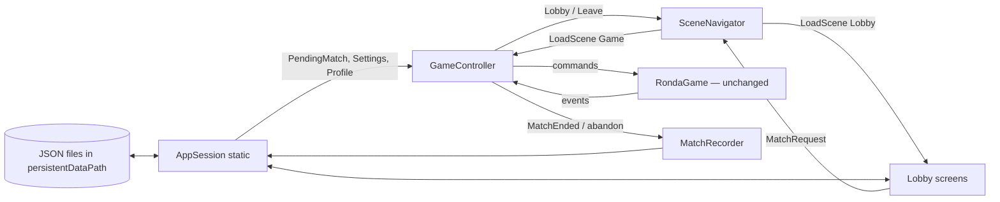

# Product 03 — Lobby Implementation Plan

**Status:** PROPOSED. Implementation waits for the owner's approval of `01_product_decisions.md` §4, items 1–11. · **Date:** 2026-11-17
**Inputs:** `01_product_decisions.md` (D-L-*), `02_lobby_specification.md` (FR-*, AC-L-*). The online track is separate: `04_online_multiplayer_architecture.md`.

**Ground rules for every phase:**
- **Keep Me vs Computer working.**
  - All 175 existing EditMode tests stay unchanged and pass.
  - The two golden-master fingerprints stay unchanged.
  - `Game.unity` must still play on its own.
- **No changes to the rules engine** (`Scripts/Core`) or the AI (`Scripts/AI`). Gameplay rules stay as they are (D-L-20).
- **No networking code, packages or services.**
- **No asset generation** without a separate approved asset request.
- Unity 2022.3, Built-in RP, uGUI + TMP, legacy input.
- **The owner commits.** Agents prepare file lists and messages only (OB-5).

---

## 1. Current architecture (as found)

| Piece | Where | Role |
|---|---|---|
| Rules engine | `Scripts/Core` (`Zellige.Core`, no engine references) | `RondaGame` (commands → `GameEvent` lists), `RulesConfig`, `CaptureRules`, cards |
| AI | `Scripts/AI` (`Zellige.AI`) | `SimpleAi` ("Nadia") |
| Match driver | `Scripts/Game/GameController.cs` (`Zellige.Game`) | Creates `RondaGame` + AIs in `StartNewMatch()`, plays events through the screen, handles input, auto-starts in `Start()` |
| Match view | `Scripts/UI/GameScreen.cs`, `CardView`, `UiKit`, `SoundFx`, `QuitDialog` (`Zellige.Game`) | Editor-authored uGUI in `Game.unity`. Events: `CardClicked`, `AnnounceClicked`, `NewGameClicked`. Result overlay with Play again. Sound toggle (not saved). |
| Scene authoring | `Scripts/Editor/GameUiBuilder.cs` | "Zellige > Build or Refresh Game UI": rebuilds the UI idempotently and saves `Game.unity` (it already adds the quit dialog) |
| Scenes | `Assets/Zellige/Scenes/Game.unity` | The only scene in Build Settings |
| Persistence | — | None (no `PlayerPrefs`, no files) |
| Scene loading | — | None at runtime |
| Android Back | `QuitDialog.Update` | Listens to `KeyCode.Escape` itself |

**Important properties:**
- The engine is deterministic and event-based. The lobby only has to *start* a match and *read* its end.
- `GameController` never assumes a lobby, which is why FR-03 (opening `Game.unity` directly) is easy to keep.

---

## 2. Target architecture (lobby milestone)

### 2.1 Scenes (D-L-04 ★)

| Build index | Scene | Contents |
|--:|---|---|
| 0 | `Assets/Zellige/Scenes/Lobby.unity` (**new**) | Canvas (same Canvas Scaler settings as `Game.unity`), EventSystem, `LobbyScreen`, the screens of spec §4, the quit dialog |
| 1 | `Assets/Zellige/Scenes/Game.unity` (existing) | Unchanged structure, plus the Home/Settings top-bar buttons, the Lobby button on the result overlay, and the Leave dialog in place of the quit dialog |

- **Loading:** `SceneManager.LoadScene(name, LoadSceneMode.Single)`. No additive scenes, no bootstrap scene, no `DontDestroyOnLoad` objects.
- **Shared state** survives scene loads because it lives in **plain static C#** (§2.2), not in GameObjects.
- **Why a separate scene and not lobby panels inside `Game.unity`:**
  - `GameUiBuilder` regenerates `Game.unity`'s UI and would have to preserve foreign objects.
  - `GameController.Start` auto-starts a match.
  - Leaving the match should free its memory (phase3/06 G6).
  - `Game.unity` stays testable on its own.

### 2.2 Scripts and responsibilities

All new runtime scripts go in `Scripts/Lobby/` and `Scripts/App/`. Both folders fall under the existing `Zellige.Game` asmdef, so no new assembly is needed. Editor scripts go in `Scripts/Editor/`.

| Script (new unless noted) | Kind | Responsibility |
|---|---|---|
| `App/MatchRequest.cs` | plain C# | `Mode` (`VsComputer`, `Online1v1`, `Online2v2`; only `VsComputer` is startable), `OpponentName = "Nadia"`. **No rule fields** (D-L-20). |
| `App/AppSession.cs` | static plain C# | Holds `Profile`, `Settings`, `Stats`, `PendingMatch`. Lazily loaded from the store. Reset at domain load via `[RuntimeInitializeOnLoadMethod(SubsystemRegistration)]`, so Editor runs never leak state. |
| `App/PlayerProfile.cs` | plain C# + validation | `DisplayName`, `AvatarId`, `CreatedUtc`, `SchemaVersion`; `TryRename(string, out error)`. |
| `App/GameSettings.cs` | plain C# | `SoundOn`, `QuickPlay`, `SchemaVersion`. |
| `App/PlayerStats.cs` | plain C# | Totals and `History` (cap 20). `RecordFinished(MatchSummary)`, `RecordAbandoned(MatchSummary)`; derived win %. |
| `App/MatchRecorder.cs` | plain C# | One recorder per match. Guarantees **exactly once** (finished or abandoned, never both, never twice). Builds `MatchSummary` from `MatchEndedEvent` plus the deck count. |
| `App/IDataStore.cs`, `App/JsonFileStore.cs`, `App/MemoryStore.cs` | interface + 2 implementations | Load/save one JSON document per key in `Application.persistentDataPath`, using `JsonUtility`. Writes go to a temp file then replace the original (atomic). A corrupt file → `.bak` copy + defaults (FR-14). `MemoryStore` serves tests. A two-class seam, **not a DI framework**. |
| `App/SceneNavigator.cs` | static | `OpenLobby()`, `StartMatch(MatchRequest)`. Scene names are constants. A reentrancy guard ignores input during a load. |
| `App/Strings.cs` | static table | Every lobby string in English (FR-15), keyed for later localisation. |
| `Lobby/LobbyScreen.cs` | MonoBehaviour | Wires the buttons, shows/hides screens, refreshes the profile chip, holds a **back stack** of open screens. |
| `Lobby/BackButtonRouter.cs` | MonoBehaviour (one per scene) | The **only** `KeyCode.Escape` listener in a scene. It asks the topmost open screen or dialog to close; at the root it runs the scene's root action: quit dialog in the Lobby, leave dialog in the match. |
| `Lobby/ProfilePanel.cs`, `AvatarPicker.cs`, `StatsPanel.cs`, `SettingsPanel.cs`, `RulesPager.cs`, `AboutPanel.cs`, `ModeSelectPanel.cs` | MonoBehaviours | One per screen of spec §4. Each reads and writes `AppSession` only. |
| `UI/ConfirmDialog.cs` | MonoBehaviour | Generic two-button confirmation (title, message, cancel and confirm labels). Built with the same code as today's quit dialog. |
| `UI/QuitDialog.cs` (**existing, kept compatible**) | MonoBehaviour | Same public API and texts, so its 5 tests keep passing. Gains an option to **not** listen to Escape itself when a `BackButtonRouter` is present; the router calls `HandleBack()`, which is already public. |
| `Editor/LobbyUiBuilder.cs` | Editor | "Zellige > Build or Refresh Lobby UI". Authors `Lobby.unity` idempotently with `UiKit`, mirroring `GameUiBuilder`. Also ensures the Build Settings order (Lobby 0, Game 1). |
| `Game/GameController.cs` (**existing, small additive changes**) | MonoBehaviour | See §2.3. |
| `UI/GameScreen.cs` + `Editor/GameUiBuilder.cs` (**existing, additive**) | — | Top-bar Home and Settings buttons; result-overlay Lobby button; new events `HomeClicked`, `LobbyClicked`, `SettingsClicked`; the profile name and avatar on the human nameplate. |
| `UI/SoundFx.cs` (**existing, 1 line**) | — | Initial `Muted` from `AppSession.Settings`. The existing toggle writes the setting back. |

### 2.3 Changes to the match flow (minimal, additive)

```text
GameController.Start():
    request = AppSession.ConsumePendingMatch() ?? MatchRequest.DefaultVsComputer   // FR-03: no lobby → same as today
    apply settings (sound, quick play); apply profile to the human nameplate
    StartNewMatch()                                                                // unchanged engine, rules, AI

StartNewMatch():
    if a recorder exists and the match is running: recorder.RecordAbandoned()      // "New game" mid-match (owner may choose otherwise)
    … unchanged …
    recorder = new MatchRecorder(AppSession.Stats, request)

on MatchEndedEvent (inside the existing PlayEvent switch, after the screen shows it):
    recorder.RecordFinished(e); AppSession.SaveStats()

Leave confirmed (Home button or Back → ConfirmDialog):
    recorder.RecordAbandoned(); AppSession.SaveStats(); SceneNavigator.OpenLobby()

OnCardClicked (quick play):
    if Settings.QuickPlay: play on the first tap (still only if CanPlay)            // FR-11; the rules path is unchanged
```

- **The engine is never touched.** The golden-master tests run the engine and AI directly, so they are unaffected by construction.
- **The match screen gains buttons only.** Nothing that is already there moves.
- `autoPlayHuman` (demo) and `fixedSeed` keep working.

### 2.4 Data flow



### 2.5 Future online seam (documented only, not built in this milestone)

Online play (product/04) will need the match screen to be driven by a **server event stream** instead of the local engine. The planned seam is an `IMatchSession` interface, with `LocalMatchSession` wrapping today's `RondaGame` + `SimpleAi` and, later, an `OnlineMatchSession`. **That refactor belongs to online phase O-3, not here.** The lobby only prepares for it by keeping the `MatchRequest.Mode` values and by not putting match logic in the lobby.

---

## 3. Reuse map

| Existing | Reused for |
|---|---|
| `UiKit` (palette, 9-slice panels, buttons, outlined labels) | Every lobby widget |
| `ui_panel`, `ui_dialog`, `ui_btn_primary/secondary`, `frame_avatar`, `ui_callout`, `icon_settings`, `icon_sound_on/off`, `icon_restart`, `avatar_01/02`, `bg_table_main` (temporary lobby background) | Lobby visuals until approved new art exists |
| Card sprites (`Resources/Zellige/Cards`) | Illustrations in How to play; decorative fan on Home |
| `QuitDialog` and its build code | Quit dialog in the Lobby; the basis of `ConfirmDialog` (Leave match, Reset stats) |
| `GameUiBuilder` pattern (idempotent, saves the scene, no duplicate Canvas/EventSystem) | `LobbyUiBuilder` |
| Canvas Scaler 1920 × 1080, Expand; responsive re-layout lessons | `Lobby.unity` |
| `GameController.StartNewMatch` | Play again; starting from the lobby |
| `MatchEndedEvent` (`Winner`, `Scores`), `DeckStartedEvent` (deck count) | Stats and history |
| `docs/mvp/01` CONFIRMED rules | Source of the How to play text |
| Responsive QA procedure (16:9, 20:9, 4:3 captures) | AC-L-11 |

---

## 4. Phases

Sizes are relative (S ≈ 1–2 days, M ≈ 3–5 days for one developer). Every phase ends with:
- the full EditMode suite green (175 + new);
- golden master unchanged;
- a clean console;
- a manual Editor run of Lobby → match → result → Lobby;
- a file list and a proposed commit message **for the owner**.

| Phase | Content | Exit criteria | Size |
|---|---|---|---|
| **L0 Approvals** | Owner answers checklist items 1–11 (product/01 §4), including the display name (D-L-18). | Decisions recorded in product/01 | — |
| **L1 Foundations (no UI)** | `MatchRequest`, `AppSession`, profile/settings/stats models, validation, `MatchRecorder`, `IDataStore` + JSON and memory stores, `Strings`. EditMode tests (§5). Fix `productName` if approved (before any data is written). | New tests green; nothing visible changes; suite 175 + new | S |
| **L2 Navigation skeleton** | `Lobby.unity` via `LobbyUiBuilder` (Home + Mode selection + "coming later" dialog + quit dialog); Build Settings order; `SceneNavigator`; `GameController` reads the request and records results; result-overlay Lobby button; match Home button + Leave dialog; `BackButtonRouter` in both scenes. | AC-L-01…06, 09, 13 in the Editor; `Game.unity` alone still works (FR-03) | M |
| **L3 Profile, statistics, settings** | Profile screen + avatar picker (2 avatars for now), Statistics & history, Settings (sound shared with the match, quick play), nameplate. | AC-L-07, 08, 10 | M |
| **L4 How to play + About** | Paged rules text, written by us and reviewed by the owner; About with notices. | Owner text approval; pages render at the 3 aspect ratios | S |
| **L5 Visual polish + device QA** | *Only after an approved asset request:* lobby background, zellige band, mode icons, about 8 avatars, optional display font (OFL). Responsive QA (AC-L-11); Android build; **device test** of AC-L-06 and AC-L-12. | Captures reviewed; device checklist signed off by whoever ran it | M |
| **L6 (optional, later) Resume** | D-L-09 option (c): store the seed + command log, offer "Resume match?" on Home, replay without animation. | Golden-master-style test: a resumed match equals an uninterrupted one | M |

**Dependencies:**
- L2 needs L1.
- L3 and L4 can run in parallel after L2.
- L5 needs the asset approval.
- L6 needs the owner's choice in D-L-09.
- The online track (product/04) does not block any lobby phase, and no lobby phase blocks the online decisions.

---

## 5. Testing strategy

| Layer | What | How |
|---|---|---|
| **Regression guard** | The 175 existing EditMode tests, including the two golden-master recordings | Run after every phase; never edited |
| **New EditMode (pure logic)**, about 25 tests in new files only | **Name validation:** trim, length 1–16, charset, invalid keeps the old name. **Settings and profile:** JSON round-trip, defaults when missing. **Corrupt file:** defaults + `.bak`. **Stats:** win % excludes abandoned; history cap 20, newest first; reset. **`MatchRecorder` exactly-once:** finish then abandon → only finish; finish twice → once; abandon after New game. **`MatchRequest`:** defaults. **Back stack:** push/pop and root action. | `MemoryStore`; no scenes, no time, no randomness without a seed (same rules as the existing suite) |
| **Editor play checks** | Lobby → match → result → Lobby ×5; Leave mid-match; Back on each screen (Escape in the Editor); `Game.unity` started alone | Manual, or through the Unity MCP bridge as in earlier milestones; console must stay clean |
| **Responsive** | Each lobby screen at 1920×1080, 2400×1080, 1440×1080 | Game-view captures |
| **Android device** | Back table (spec §3.3), airplane mode (AC-L-12), app paused/resumed in the lobby and in a match, data kept across restart | Device checklist. **Results are reported only from a real device run; Editor results are never presented as device validation.** |
| **Static checks** | No `UnityEngine.Networking`, `HttpClient`, `WebSocket`, `UnityWebRequest` or UGS/Photon/Nakama references in the lobby code | grep in review |

---

## 6. Risks to the existing playable MVP

| # | Risk | Likelihood / impact | Mitigation |
|---|---|---|---|
| R1 | Changes to `GameController` / `GameScreen` break the match flow | M / H | Changes are additive; the no-request path is today's path (FR-03); golden master + 175 tests + a full manual match each phase |
| R2 | **Build Settings order wrong:** the app boots into the match, or Lobby is missing from the build | M / M | `LobbyUiBuilder` enforces the order; checked in the L2 exit criteria and the APK smoke test |
| R3 | **Two Escape listeners** (today `QuitDialog.Update` plus the new router) handle the same press, so Back closes a screen *and* opens the quit dialog | M / M | One `BackButtonRouter` per scene; `QuitDialog` stops self-listening when a router is present; Back-stack tests |
| R4 | Results double-counted, or lost, when Play again / Lobby / Leave are combined | M / M | `MatchRecorder` exactly-once guard + tests (AC-L-03/04/05) |
| R5 | Static `AppSession` keeps stale state between Editor play sessions when domain reload is disabled | L / M | Reset in `RuntimeInitializeOnLoadMethod(SubsystemRegistration)` |
| R6 | Fixing `productName` later moves `persistentDataPath`, so saved profiles look lost | M (if postponed) / M | Decide D-L-18 in L0 and apply it in L1, before any data exists |
| R7 | Memory or object leaks across repeated scene loads (coroutines, event subscriptions, generated audio clips) | L / M | Single loads destroy scene objects; no `DontDestroyOnLoad`; AC-L-13 counts objects |
| R8 | `GameUiBuilder` refresh drops the new buttons, or duplicates objects | L / M | New buttons are created *by the builder*, never by hand; idempotency checked as in earlier milestones |
| R9 | Android Back behaviour is still unverified on a device (the M2 quit-dialog device test is pending) | known / M | Device checklist in L5; nothing is claimed before it |
| R10 | Typed names contain characters the current font cannot show | L / L | Charset restriction in validation (spec §4.3); TMP fallback |
| R11 | Scope creep into online features (accounts, rooms) during lobby work | M / H | Locked cards only; static review for networking references; online work only in the product/04 phases after approval |
| R12 | Quick play increases mis-taps | L / L | Default stays two-step; illegal cards are still refused |

---

## 7. Commit checkpoints (prepared for the owner; agents do not commit)

| After | Suggested scope of the owner's commit |
|---|---|
| L1 | `App/*` models and stores, new tests |
| L2 | `Lobby.unity`, `LobbyUiBuilder`, navigation, the `GameController`/`GameScreen`/`GameUiBuilder` additions, `Game.unity` refresh, `EditorBuildSettings.asset` |
| L3 | Profile/stats/settings screens and their tests |
| L4 | Rules and About pages + strings |
| L5 | Approved art + import settings, QA captures (if kept), device checklist notes |

Unity Version Control caches (`ronda_game/.plastic/*`) and build-debug folders are never part of these commits.
