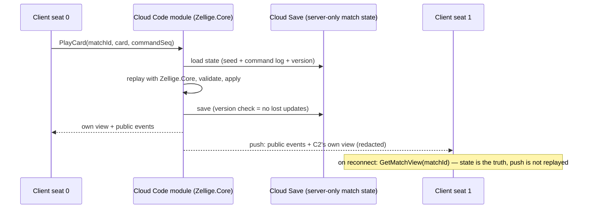

# Product 04 — Online Multiplayer: Product Journeys, Backend Options and Phases

**Status:** PROPOSED. Planning only. **No networking code, package, account or service is created by this document.** · **Date:** 2026-11-17
**Owner inputs:**
- OB-4 (`01_product_decisions.md` §0.1): Me vs Computer is local; 1 vs 1 and 2 vs 2 are online with human players.
- The backend must be authoritative.
- Me vs Computer must stay playable without a backend.
- A local profile does not imply an online account.

**Relationship to Phase 3.**
- `docs/phase3/07_multiplayer_backend_architecture.md` already holds the detailed long-term backend design: protocol, matchmaking parameters, rating, persistence schema, security table.
- This document **does not repeat it**. It:
  1. adds the product journeys;
  2. re-evaluates the platform with **Nakama, Photon Fusion and Unity Gaming Services** as the owner asked, keeping Phase 3's custom .NET recommendation as the baseline;
  3. records what changed since Phase 3: the engine now exists as `Zellige.Core`, and the client is Unity 2022.3 + uGUI;
  4. defines phases that are separate from the lobby.

---

## 1. Fixed principles

1. **Server-authoritative** (D-S-01, CONFIRMED by OB-4).
   - The server deals, validates every command with the rules engine, computes every score, and owns timers.
   - Clients send **intents** (play this card, announce, leave) and render **events**.
2. **Hidden information never leaves the server:**
   - other players' hands;
   - the undealt deck;
   - the shuffle seed until the match ends;
   - sealed announcements until the window closes.
3. **One rules implementation.**
   - `Zellige.Core` is pure C# with no Unity references, and it is deterministic (proven by the golden master).
   - Reusing it on the server avoids a second implementation drifting from the first.
4. **Offline stays offline.** Me vs Computer never needs a network, an account or a server (OB-4).
5. **Local data is untrusted.** Local profiles and stats are never accepted as online data (D-O-12).
6. **Nothing is provisioned without approval:** no accounts, packages, cloud projects or spending (D-P-06).

---

## 2. Online user journeys

| # | Journey | Steps (happy path) | Failure paths |
|---|---|---|---|
| J1 | **First online use** | Mode selection → 1 vs 1 → a one-time notice: "Online play needs a free online profile (no email needed)" → anonymous sign-in → online profile created with the local name and avatar copied (D-O-04) → continue to J2 or J3 | No network → "You're offline — play against Nadia instead"; sign-in error → retry or back |
| J2 | **Quick match 1v1** | Choose 1 vs 1 → Quick match → "Looking for a player…" (elapsed time, Cancel) → match found → table loads with both names → play → result → Lobby or Play again (re-queue) | Cancel at any time before the match starts; long wait → "No players right now — try a private room or play Nadia" (no bot fill, D-O-02 ★) |
| J3 | **Private room** | Choose 1 vs 1 or 2 vs 2 → Create room → room code shown + Share (system share sheet) → friends join by code → seats fill → host taps Start | Code expired or invalid → message; a player leaves before start → seat reopens; host leaves → room closes (or host migrates; to decide) |
| J4 | **Join by code** | Mode selection → Join room → enter the code → seat taken → wait for host | Room full / already started / not found |
| J5 | **2v2** | Solo: queue, the server forms two teams (partners opposite). Party: create a private room with a friend, then queue as a pair (later, D-O-07). | A partner disconnects → autopilot for that seat (J6) |
| J6 | **Disconnect and return** | Connection lost → banner "Reconnecting…" → within the grace period: resume to the current state → "Back in the game" | Grace expired → seat on autopilot until the player returns or the match ends (D-O-02 ★); app killed → on next launch Home offers "Return to your match" while it is still running |
| J7 | **Leave on purpose** | Home / Back → "Leave the match? Your seat will be played automatically" → Lobby | Ranked forfeit rules only if ranked exists (D-O-03 ★) |
| J8 | **After the match** | Result with the itemised score → stats and history updated **by the server** → Lobby / Play again | Server unreachable at the end → result shown from the last event; history syncs later |
| J9 | **Version mismatch** | Client too old → "Update required" with a store link; offline play still available | — |

---

## 3. Topic-by-topic design (provider-neutral)

| Topic | Design | Phase 3 reference |
|---|---|---|
| **Accounts and authentication** | Anonymous (device) sign-in on first online use; later optional Google (and Apple, if iOS) linking to recover the account on a new phone. The server maps provider ids to an internal player id. No email or password in the first release. Display names are validated server-side (length, charset, profanity list). | D-S-05, phase3/02 §9 |
| **Matchmaking** | Casual quick match only at first (D-O-03 ★): first-come pairing per mode and region. Rating-based matching (Glicko-style) only when ranked is approved. | phase3/07 §6 |
| **Rooms and private tables** | Server-created room; 6-character code from an unambiguous alphabet; time-to-live; host starts; 1v1 needs 2 seats, 2v2 needs 4 (partners opposite). | phase3/04 §7.1 |
| **Invitations** | Share the code or a deep link through the system share sheet. No friends list, contact access or in-app invitations in the first online release. | D-O-06 |
| **Turn management and sync** | The server holds the state. After each accepted command it sends each seat **its own view** (own hand, public table, counts, scores, whose turn, deadlines) plus the public events. Clients never compute outcomes; they animate events. Every command carries a sequence number, so duplicates are ignored. | phase3/04 §8.1, phase3/07 §5 |
| **Timers** | Turn deadline (D-O-09 ★, 20 s proposed) and announcement window stored as **absolute server times in the match state**. Client countdowns are cosmetic. | D-G-17, RL-15 |
| **Disconnect / reconnect** | Grace period (60 s proposed). The seat stays reserved; when its turn deadline passes, autopilot plays a legal card (labelled). Resume = fetch the current per-seat view, then continue the event stream. | D-S-09, phase3/07 §8 |
| **Server-authoritative rules and scoring** | `Zellige.Core` runs on the server where the platform allows C# (see §4). Every score comes from the engine's `ScoreAwardedEvent` with its reason (RL-26). The client's `RulesConfig` is irrelevant online; the server pins the ruleset per match. | D-G-20 |
| **Persistence and history** | Per match: id, mode, seats, ruleset version, seed (revealed after the end), ordered command log, final scores, timestamps. Per player: profile, per-mode stats, recent-match list. The command log + seed reproduce the whole match (determinism), for disputes and anti-cheat review. Retention per the privacy policy (D-O-14 ★). | D-S-06, phase3/07 §9 |
| **Hosting, deployment, monitoring** | One EU region first (D-S-13). Environments: dev, staging, production. Every deploy carries a ruleset/protocol version; running matches finish on their version. Monitoring: command latency, errors by code, active matches, reconnect rate, autopilot rate, abandoned matches, cost per day. | D-S-12, phase3/07 §12 |
| **Security and score integrity** | Authenticated sessions bound to a seat; the engine validates every command; illegal or out-of-turn commands are rejected and logged; rate limits; no free-text chat; redacted views tested automatically; the shuffle seed is server-generated; stats and history are written only by the server; local Me vs Computer data is never uploaded. | D-S-11, phase3/07 §11 |

---

## 4. Platform evaluation (D-O-05 ★, revisits D-S-02)

### 4.1 Facts used (checked 2026-11-17)

| Fact | Confidence |
|---|---|
| Unity **Multiplay Game Server Hosting was deprecated on 31 March 2026**. Matchmaker, Relay, Lobby and Distributed Authority continue. The standalone Lobby/Relay/Matchmaker SDKs are deprecated in favour of the **Multiplayer Services SDK** (`com.unity.services.multiplayer`). | Unity status notice and Unity docs/forum (verified) |
| **UGS Cloud Code C# modules** run .NET code server-side and cannot use Unity runtime APIs (phase3/07 §2). | Unity docs (verified 2026-11-12) |
| Cloud Code modules can **push messages to players over a WebSocket** (`SendPlayerMessage`). Clients subscribe with `SubscribeToPlayerMessagesAsync` (Cloud Code SDK 2.4.0+). **Push messages are not stored or replayed** for players who connect later. | Unity Cloud Code docs (verified) |
| **Nakama** core is **Apache-2.0** (free to self-host). Authoritative matches are written in **Go, TypeScript or Lua** and run on a fixed tick loop. It includes auth, storage, matchmaker, parties and leaderboards. Managed Heroic Cloud entry pricing is reported at **about $600/month**. | Heroic Labs docs (verified); **pricing third-party, unverified** |
| **Photon Fusion 2**: *Server Mode* is the authoritative mode and needs **your own headless Unity server hosting** (Photon does not host it). Host and Shared modes give weaker integrity. Every networked mode counts toward the CCU price; 100 CCU free. Paid tier prices are reported by third parties but **not verified**. Fusion 2.1 is the current line. Photon's own guidance points turn-based games to Photon *Realtime* (+ server plugins) and cheat-sensitive PvP to Fusion Server Mode. | Photon docs index and forum (verified for modes); **prices unverified** |
| Phase 3 sensitivity analysis: with "small team, speed first" weights, **UGS (3.85) and Nakama (3.75) outrank the custom .NET server (3.35)**. | phase3/07 §3.3 |

Sources:
- [Unity Multiplay deprecation notice](https://status.unity.com/info_notices/362941)
- [Unity Matchmaker support](https://docs.unity.com/en-us/matchmaker/support)
- [Cloud Code push messages](https://docs.unity.com/en-us/cloud-code/modules/how-to-guides/push-messages)
- [Cloud Code push channels](https://docs.unity.com/en-us/cloud-code/cloudbehaviours/push-channels)
- [Multiplayer Services SDK changelog](https://docs.unity3d.com/Packages/com.unity.services.multiplayer@2.2//changelog/CHANGELOG.html)
- [Nakama authoritative multiplayer](https://heroiclabs.com/docs/nakama/concepts/multiplayer/authoritative/llm.md)
- [Nakama pricing summary (third party)](https://crux.supercraft.host/blog/nakama-open-source-vs-managed-backend/)
- [Photon docs index](https://www.photonengine.com/llms.txt)
- [Photon pricing](https://doc.photonengine.com/photon/current/pricing)
- [Photon Fusion pricing summary (third party)](https://crux.supercraft.host/blog/photon-fusion-pricing-2026/)
- [Photon Fusion dedicated server notes (third party)](https://crux.supercraft.host/blog/photon-fusion-dedicated-server-backend/)
- [Photon forum: hidden cards need server logic](https://forum.photonengine.com/discussion/comment/43382/)

**All prices must be re-checked on the vendors' own pages before any budget decision.**

### 4.2 What Ronda needs from a backend (shapes the comparison)

- **Turn-based and low-frequency:** about 150–250 commands per match, a few seconds apart. No physics, no real-time state sync.
- **Hidden information** is central: hands, the deck, sealed announcements.
- **Timers** of seconds, not milliseconds.
- **Small payloads.**
- **Reuse of the C# engine** is the biggest correctness lever: the golden master and the 175 tests then protect online play too.

### 4.3 Comparison

Ratings (1 = poor, 5 = excellent) are design judgement from the facts above, not measurements.

| Criterion | **A. Custom .NET server** (Phase 3 baseline) | **B. Unity Gaming Services** (Auth + Cloud Code C# + Lobby + Cloud Save + push) | **C. Nakama** | **D. Photon Fusion 2** (Server Mode) |
|---|---|---|---|---|
| Reuse of `Zellige.Core` (C#) | 5: same assembly | 4–5: C# module references the same code (to prove in spike S-O1) | 1–2: rules rewritten in TS/Go/Lua → two sources of truth (or a sidecar C# service, which adds complexity) | 4: headless Unity server runs it directly |
| Hidden information | 5 | 4: state kept server-side; per-seat views pushed | 5 | 3: possible with per-player targeted messages; default replication is designed for shared state |
| Turn and timer model | 5: long-lived room process | 3: request/response; deadlines stored in state and enforced on the next request or by a "claim timeout" call (spike S-O2) | 5: tick loop with timers | 4: tick loop (built for real-time; more than needed) |
| Reconnect | 5 | 4: resume = fetch view (push is not replayed, so the stored state is the truth) | 5 | 4 |
| Accounts / auth | 2: integrate a provider | 5: built in (anonymous + platform linking) | 5: built in | 1: none (needs another service) |
| Rooms, codes, matchmaking | 2: build | 4: Lobby (private + join codes, quick-join); Matchmaker available | 5: matchmaker, parties | 3: rooms; skill matchmaking and persistence are not included |
| Persistence, history, leaderboards | 2: build (Postgres) | 4: Cloud Save, Leaderboards | 5: storage, leaderboards | 1: none (needs another backend) |
| Operational burden | 1–2: servers, DB, scaling, on-call | 5: managed, serverless | 3 self-hosted / 5 managed (Heroic Cloud) | 2: you run and orchestrate headless servers (Multiplay is gone) plus pay CCU |
| Cost model | infra (VMs/containers + DB), predictable, needs ops time | usage-based with a free tier (amounts to verify) | self-host: VM + DB; managed: about $600/mo reported (verify) | CCU tiers (100 free) **plus** server hosting |
| Lock-in | low | medium–high (the module stays a thin adapter around `Zellige.Core`) | low (open source) | high |
| Fit with Unity 2022.3 client | any (WebSocket client) | official SDK packages (2022.3 support to confirm in spike) | official Unity SDK | official SDK |
| Fit for a small / academic team (D-P-07 unknown) | weak | strong | medium | weak |

### 4.4 Assessment

- **Photon Fusion 2: not recommended.**
  - It solves real-time state replication, which Ronda does not need.
  - Its authoritative mode requires us to host and orchestrate headless Unity servers (now without Multiplay), and it still lacks accounts, persistence and history.
  - That means two vendors plus servers for a turn-based card game.
  - If Photon is preferred for other reasons, its turn-based path (Realtime + server plugins/webhooks) should be evaluated instead of Fusion.
- **Nakama: strong features, wrong language for us.**
  - It has everything a card game needs, and the open-source core avoids lock-in.
  - But authoritative logic must be written in Go/TS/Lua. The engine, with its rules, settings H-1…H-10, tests and golden master, would have to be ported and kept identical forever.
  - Recommended only if the team prefers Go/TS **and** accepts a ported engine verified against shared golden vectors.
- **UGS: recommended default, after a spike.**
  - It reuses `Zellige.Core` in a C# module and covers accounts, rooms with codes, matchmaking and storage as managed services. It needs no servers, which matches an unknown or small team (D-P-07) and Phase 3's own sensitivity analysis.
  - Its weak points are known and testable:
    - timers without a long-running process;
    - push messages that are not replayed;
    - concurrent commands on one match;
    - usage cost;
    - vendor lock-in (shown in 2026 by the Multiplay deprecation).
- **Custom .NET: fallback, with no wasted work.**
  - It is the best technical fit (Phase 3's base case) but the heaviest to operate.
  - Because both B and A run the same `Zellige.Core` behind a thin command/view adapter, the work done for B (engine snapshot/replay, per-seat views, timeouts) carries over unchanged if the spike fails or costs grow.

**Recommendation for owner approval (★): B (UGS) as the default, conditional on spikes S-O1…S-O3 passing; A (custom .NET) as the fallback; C and D not selected.** This **revises** Phase 3's D-S-02 default (custom .NET) because the team and budget question (D-P-07) is still open and the engine is now proven reusable. **Nothing is selected until the owner approves.**

### 4.5 Sketch of the UGS design (to be validated by the spikes)

- **Rooms:** UGS Lobby (private lobbies with join codes, quick-join for casual quick match). When the seats are full, the host calls `StartMatch`, which creates the match state.
- **Timers:** deadlines live in the state. Any call after a deadline triggers autopilot for the late seat (`SimpleAi` is pure C# and can be reused). The waiting client calls `ClaimTimeout` when its local countdown ends, and the server checks against **its own** clock.

---

## 5. Engine and client prerequisites (needed whichever platform is chosen)

| # | Work | Where | Guard |
|---|---|---|---|
| E-1 | **Match persistence:** restore a match from seed + ordered command log (replay), and/or a full state snapshot. | `Zellige.Core` | New tests; golden master unchanged |
| E-2 | **Per-seat view:** a projection that contains only what a seat may see; redaction tests (no other hand, no deck order, sealed announcements hidden). | `Zellige.Core` | New tests |
| E-3 | **Determinism across runtimes:** run the golden-master recordings on the server's .NET runtime and compare fingerprints. This validates `System.Random` and ordering behaviour outside Unity's Mono/IL2CPP. | spike S-O1 | Same two fingerprints |
| E-4 | **Timeouts and autopilot:** deadline fields; an autopilot policy (`SimpleAi`) applied on timeout. | Core / AI | New tests |
| E-5 | **2v2 generalisation:** 4 seats, sides, shared piles, 4/3/3 deal pattern, side-level announcements and dealer rule (RL-03, RL-05, RL-16, RL-20). Today `PlayerCount = 2` is a hard assumption. **Requires D-O-10 rules decisions first**; several 2v2 rules are tutorial-only evidence. | `Zellige.Core`, AI, UI (4 seats) | Large; existing 1v1 tests and golden master must stay unchanged |
| E-6 | **Client seam:** `IMatchSession` with `LocalMatchSession` (today's engine + Nadia) and later `OnlineMatchSession` (server events), so the same `GameScreen` serves both. | `Zellige.Game` | Golden master + a full manual match in Me vs Computer |
| E-7 | **Online UI:** sign-in notice, queue screen, room screen (code, seats, Start), reconnect banner, autopilot overlay, update-required screen. | `Zellige.Game` | Spec to be written in the online phase |

---

## 6. Phases (online track: separate from the lobby, each gated by the owner)

| Phase | Content | Gate to start | Exit |
|---|---|---|---|
| **O0 Decisions** | D-P-07 (team, budget), D-O-02, D-O-03, D-O-05, D-O-09, D-O-11, D-O-14; privacy approach. | Owner | Answers recorded in product/01 |
| **O1 Spikes** (throw-away, outside the game project or on a separate branch) | **S-O1:** a UGS Cloud Code C# module referencing `Zellige.Core`, playing a full scripted match through calls, with server-only state, push to two test clients, a version check on concurrent writes, and the golden master run on the server runtime (E-3). **S-O2:** timeout enforcement without a long-running process. **S-O3:** a cost model per 1,000 matches from the current price list. | O0 approves the spike (a UGS project/account needs explicit approval) | Pass/fail report; if fail → custom .NET path (A) |
| **O2 Engine preparation** | E-1, E-2, E-4 in `Zellige.Core` with tests. | O1 pass (or fallback chosen) | Suite green; golden master unchanged |
| **O3 Client seam** | E-6 (`IMatchSession`); Me vs Computer moved onto `LocalMatchSession`. | O2 | Me vs Computer identical (golden master + manual) |
| **O4 Online 1v1, private rooms (alpha)** | Anonymous auth, profile copy (D-O-04), create/join by code, server match, per-seat views, result + server history; closed test with known testers. | O3 + privacy basics (D-O-14) | Two devices finish matches; disconnect test; no hidden data in any client payload (automated check) |
| **O5 Quick match + reconnect + autopilot** | Casual quick match, grace period, autopilot, "Return to your match", update-required. | O4 | Reconnect success target met in tests; cost alerts in place |
| **O6 2v2 online** | E-5 + 4-seat UI + team formation. | D-O-10 rules decisions; O5 | 2v2 rule tests; 1v1 unchanged |
| **O7 Hardening and release readiness** | Security review (commands, rate limits, redaction), monitoring dashboards and alerts, load test, privacy/legal sign-off, data export/delete. | O5/O6 | Release criteria (phase3/11 §5 adapted) |

**Separation from the lobby.** The lobby (product/03) ships first and has **no dependency** on any O-phase. The only hand-off point is the `MatchRequest.Mode` values and the locked mode cards. In O4 those become enabled entry points into the online flow.

---

## 7. Open online questions (all ★, owner)

| ID | Question | Recommended default |
|---|---|---|
| D-P-07 | Team size, server skills, monthly budget | — (answer needed) |
| D-O-02 | Bots online: none, or labelled autopilot only for absent humans? | Autopilot only; no bot-fill |
| D-O-03 | Ranked at the first online release? | No: casual and private only |
| D-O-05 | Backend platform | UGS after spikes; custom .NET fallback |
| D-O-09 | Turn timer length | 20 s; tune in the alpha |
| D-O-10 | 2v2 rule set (aggregation, dealer rule level, Derba escalation) | Phase 3 RL defaults; no escalation |
| D-O-11 | Budget ceiling, region | EU region; a cost model before any account is created |
| D-O-14 | Privacy policy, data retention, minors | Counsel review before O4 |
| — | Host leaves a private room before start | Room closes; guests are told |
